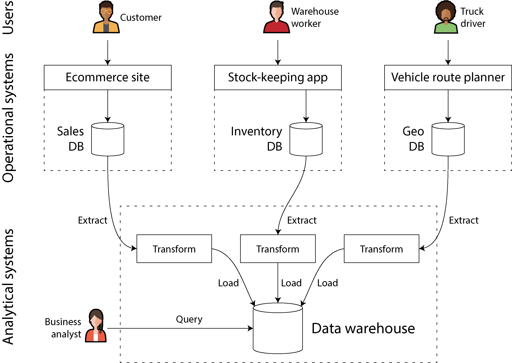
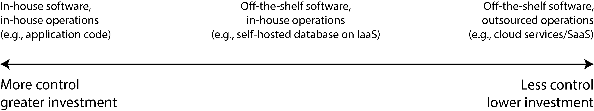

# 📘 Глава 1. Компромиссы в архитектуре систем данных

*Ориг.: Chapter 1. Trade-Offs in Data Systems Architecture (стр. 1–26 + список литературы до стр. 31)*

> «Решений не существует — существуют только компромиссы. […] Ты пытаешься найти лучший компромисс из возможных, и это всё, на что можно надеяться».
> — Томас Соуэлл, интервью Фреду Барнсу (2005)

---

### 🔹 Вступление

- Сегодня данные — центр разработки многих приложений. С веб- и мобильными приложениями, **SaaS** и облачными сервисами стало нормой хранить данные многих пользователей в **общей серверной инфраструктуре данных**.
- Данные о действиях пользователей, бизнес-транзакциях, с устройств и датчиков нужно хранить и делать доступными для анализа. Пользователи, работая с приложением, и **читают** сохранённые данные, и **порождают новые**.
- Небольшие объёмы, которые помещаются и обрабатываются **на одной машине**, обычно не вызывают трудностей. Но когда растёт объём данных или частота запросов, данные приходится **распределять по нескольким машинам**, а это порождает много проблем.
- Когда потребности приложения усложняются, одной системы для хранения уже недостаточно: приходится **комбинировать несколько систем хранения и обработки** с разными возможностями.

**Data-intensive приложение** — приложение, в разработке которого **управление данными** — одна из главных трудностей.
- В **compute-intensive** системах трудность — распараллелить очень большое вычисление.
- В **data-intensive** приложениях чаще волнуют: хранение и обработка больших объёмов данных, управление изменениями данных, **обеспечение согласованности при сбоях и конкурентном доступе**, **высокая доступность** сервисов.

Такие приложения обычно строят из **стандартных строительных блоков**. Многим приложениям нужно:
- **хранить данные**, чтобы они сами или другое приложение могли потом их найти → **базы данных**;
- **запоминать результат дорогой операции**, чтобы ускорить чтение → **кэши**;
- давать пользователям **искать по ключевым словам** и фильтровать данные разными способами → **поисковые индексы**;
- **обрабатывать события и изменения данных сразу**, как только они происходят → **потоковая обработка**;
- **периодически перемалывать большой объём накопленных данных** → **пакетная обработка**.

- Приложение обычно собирают из нескольких программных систем или сервисов (БД, API) и **склеивают их кодом приложения**. Если делать ровно то, для чего системы задуманы, это несложно.
- Но чем амбициознее приложение, тем больше трудностей: СУБД много, у них разные характеристики и назначение — **какую выбрать?** Подходов к кэшированию и построению поисковых индексов тоже несколько — **как рассуждать об их компромиссах?** Нужно понять, какие инструменты и подходы лучше подходят к задаче, а комбинировать инструменты, когда один не справляется, бывает трудно.
- Книга — путеводитель по выбору технологий и их комбинированию. **Ни один подход не лучше остальных принципиально — у всего есть плюсы и минусы.** Цель — научиться **задавать правильные вопросы**, чтобы оценивать и сравнивать системы данных и понять, что лучше подходит конкретному приложению.

- Многие идеи пришли из **enterprise-софта** (потребности и инженерные практики крупных организаций — корпораций, государств): исторически только у них были объёмы данных, требующие сложных решений. Если данных мало, можно просто держать их **в электронной таблице**! Но в последнее время и небольшие компании и стартапы всё чаще управляют большими объёмами и строят data-intensive системы.
- Одна из ключевых трудностей: **разным людям нужно делать с данными очень разные вещи**. У вашей команды одни приоритеты, у другой — совсем другие цели, хотя набор данных может быть тот же! К тому же эти цели часто **не проговорены явно**, что ведёт к непониманию и спорам о «правильном» подходе.

Чтобы помочь разобраться в вариантах, глава сравнивает несколько **противоположных понятий** и их компромиссы:
1. Чем отличаются **операционные и аналитические** системы.
2. Плюсы и минусы **облачных сервисов и self-hosted** систем.
3. Когда переходить от **одноузловых систем к распределённым**.
4. Баланс между **потребностями бизнеса и правами пользователя**.

Также глава вводит терминологию, нужную в остальной книге.

---

### 🔹 Врезка: терминология — фронтенд и бэкенд

- Большая часть книги — про **бэкенд-разработку**.
- В веб-приложениях **фронтенд** — клиентский код (выполняется в браузере), **бэкенд** — серверный код, обрабатывающий запросы пользователей.
- **Мобильные приложения** похожи на фронтенд: дают интерфейс и часто общаются через интернет с серверным бэкендом.
- Фронтенд иногда хранит данные локально на устройстве пользователя, но **главные трудности инфраструктуры данных обычно на бэкенде**: фронтенд работает с данными **одного** пользователя, а бэкенд — с данными **всех**.
- Бэкенд-сервис обычно доступен по **HTTP** (иногда **WebSocket**). Как правило, это код приложения, который читает и пишет данные в одну или несколько БД, а иногда работает и с другими системами — **кэшами, очередями сообщений** (всё вместе можно назвать **инфраструктурой данных**).
- Код приложения часто **stateless**: обработав HTTP-запрос, он забывает о нём всё. Всё, что должно сохраняться между запросами, хранится **на клиенте** или **в серверной инфраструктуре данных**.

---

## 1️⃣ Операционные vs аналитические системы

- В enterprise с данными работают несколько типов людей. Первый — **бэкенд-инженеры**: строят сервисы, обрабатывающие запросы на чтение и обновление данных. Эти сервисы часто обслуживают внешних пользователей (напрямую или через другие сервисы), иногда — внутренних, другие подразделения организации.
- Ещё две группы, которым нужен доступ к данным:
  - **бизнес-аналитики** — делают отчёты о деятельности организации, чтобы руководство принимало лучшие решения (**business intelligence, BI**);
  - **data scientists** — ищут в данных новые инсайты или создают продуктовые фичи на основе анализа данных и **ML/AI** (рекомендации «купившие X покупали и Y» в интернет-магазине, предиктивная аналитика вроде **скоринга рисков** или **фильтрации спама**, **ранжирование результатов поиска**).
- Инструменты и способы работы у аналитиков и data scientists разные, но общее есть:
  1. оба занимаются **аналитикой** — смотрят на данные, которые породили пользователи и бэкенд-сервисы;
  2. обычно **не изменяют** эти данные (разве что исправляют ошибки), хотя могут создавать **производные наборы данных**, где исходные данные как-то обработаны.

Отсюда разделение на два типа систем, которое проходит **через всю книгу**:
- **Операционные системы** — бэкенд-сервисы и инфраструктура данных, где данные **создаются** (например, при обслуживании внешних пользователей). Код приложения и **читает, и изменяет** данные в своих БД в ответ на действия пользователей.
- **Аналитические системы** — обслуживают бизнес-аналитиков и data scientists. Содержат **read-only копию** данных из операционных систем и **оптимизированы** под обработку, нужную для аналитики.

- Операционные и аналитические системы часто держат **раздельно**, и на то есть веские причины (см. следующий раздел).
- С развитием этих систем появились две новые роли:
  - **data engineers** — умеют интегрировать операционные и аналитические системы и отвечают за инфраструктуру данных организации в целом;
  - **analytics engineers** — моделируют и преобразуют данные, чтобы ими было удобнее пользоваться аналитикам и data scientists.
- Многие инженеры специализируются на одной стороне, но книга охватывает **обе**, потому что обе важны в жизненном цикле данных в организации. Цель — чтобы вы лучше работали с коллегами «по ту сторону».

### 🔹 Обработка транзакций и аналитика: характеристики

- На заре обработки бизнес-данных запись в БД обычно соответствовала **коммерческой транзакции**: продажа, заказ у поставщика, выплата зарплаты сотруднику. Когда БД стали применять там, где деньги из рук в руки не переходят, термин **«транзакция»** всё равно прижился — так называют **группу чтений и записей, образующих логическую единицу**.

> 📝 Что именно такое транзакция — подробно в главе 8. В этой главе термин используется **нестрого**: просто чтения и записи с **низкой задержкой**.

- БД стали хранить самые разные данные — посты в соцсетях, ходы в игре, контакты в адресной книге и многое другое, — но **базовый паттерн доступа** остался похож на обработку бизнес-транзакций:
  - операционная система обычно ищет **небольшое число записей по ключу** — это называется **точечный запрос (point query)**;
  - записи **вставляются, обновляются или удаляются** по вводу пользователя.
- Поскольку такие приложения **интерактивны**, этот паттерн назвали **OLTP (online transaction processing)**.

> **💡 Пояснение: OLTP простыми словами** *(вставка, не из текста книги)*
>
> **OLTP — «онлайн-обработка транзакций»**: так работает БД «за кнопками» обычного приложения. Пользователь ждёт ответа сейчас, каждый запрос трогает **несколько записей по ключу**, но запросов **очень много**.
> Пример — интернет-магазин: открыть карточку товара (прочитать запись по `id`), положить в корзину (вставить запись), оформить заказ (создать заказ, уменьшить остаток).
> Подробно → [OLTP и OLAP](../../../topics/OLTP%20и%20OLAP.md)

- БД всё чаще использовали и для **аналитики**, а у неё паттерны доступа совсем другие. Аналитический запрос обычно **сканирует огромное число записей** и считает **агрегатную статистику** (count, sum, average), а не возвращает пользователю отдельные записи.
- Пример — бизнес-аналитик сети супермаркетов хочет знать:
  - какая общая выручка у каждого нашего магазина в январе?
  - насколько больше обычного бананов мы продали во время последней акции?
  - какую марку детского питания чаще всего покупают вместе с подгузниками марки X?
- Отчёты по таким запросам важны для BI — помогают руководству решать, что делать дальше. Чтобы отличать этот паттерн от обработки транзакций, его назвали **OLAP (online analytical processing)**.

> **💡 Пояснение: OLAP простыми словами** *(вставка, не из текста книги)*
>
> **OLAP — «онлайн-аналитическая обработка»**: так работают с данными аналитики. Запросов **мало**, но каждый **сканирует миллионы записей** и считает итог (сумму, среднее, количество), а не возвращает отдельные строки.
> Пример — тот же интернет-магазин: «выручка по категориям за квартал», «какие товары чаще покупают вместе».
> Метафора: OLTP — **кассир**, пробивающий чеки по одному; OLAP — **бухгалтер в конце месяца**, который берёт все чеки разом и считает итоги.
> Подробно → [OLTP и OLAP](../../../topics/OLTP%20и%20OLAP.md)
- Граница между OLTP и аналитикой **не всегда чёткая**, но типичные характеристики — в таблице.

**Таблица 1-1. Сравнение характеристик операционных и аналитических систем**

| Свойство | Операционные системы (OLTP) | Аналитические системы (OLAP) |
|---|---|---|
| Основной паттерн чтения | Точечные запросы (получить отдельные записи по ключу) | Агрегация по большому числу записей |
| Основной паттерн записи | Создание, обновление, удаление отдельных записей | Массовый импорт (ETL) или поток событий |
| Пример пользователя-человека | Конечный пользователь веб/мобильного приложения | Внутренний аналитик, для поддержки решений |
| Пример машинного использования | Проверка, разрешено ли действие | Выявление паттернов мошенничества/злоупотреблений |
| Тип запросов | Фиксированные, заранее заданы приложением | Произвольные, ad-hoc исследование аналитиками |
| Объём запросов | Много маленьких запросов | Мало запросов, каждый сложный |
| Что представляют данные | Последнее состояние данных (текущий момент) | История событий, произошедших со временем |
| Размер набора данных | Гигабайты – терабайты | Терабайты – петабайты |

> 📝 Смысл слова **online** в OLAP неясен. Вероятно, имеется в виду, что запросы делаются не только для заранее заданных отчётов: аналитики используют OLAP-систему **интерактивно**, для исследовательских запросов.

- В операционных системах пользователям обычно **не разрешают писать свои SQL-запросы** и запускать их в БД:
  - так можно прочитать или изменить данные, к которым нет доступа;
  - можно написать дорогой запрос и просадить производительность БД для остальных.
- Поэтому OLTP-системы в основном выполняют **фиксированный набор запросов, зашитый в код приложения**. Разовые произвольные запросы — лишь изредка, для обслуживания или диагностики.
- Аналитические БД, наоборот, обычно дают **свободу писать произвольные SQL-запросы** вручную или генерировать их автоматически инструментами визуализации и дашбордов — **Tableau, Looker, Microsoft Power BI**.

- Есть ещё тип систем: нагрузка **аналитическая** (агрегация по многим записям), но **встроена в продукты для пользователей**. Это **product analytics / real-time analytics**: **Pinot, Druid, ClickHouse**.
  - Они принимают данные **в реальном времени** и оптимизированы под **низкую задержку** ответа на запрос.
  - Традиционные OLAP-системы принимают данные **пачками (batch)** и оптимизированы под **высокую пропускную способность** обработки запросов.

---

### 🔹 Хранилище данных (Data Warehousing)

- Сначала одни и те же БД использовали **и для транзакций, и для аналитики**: SQL оказался достаточно гибким и хорошо подходил для обоих типов запросов.
- В **конце 1980-х — начале 1990-х** появился тренд: перестать использовать OLTP-системы для аналитики и запускать аналитику в **отдельной системе БД**. Её назвали **хранилищем данных (data warehouse)**.
- В крупной компании могут быть **десятки, даже сотни** OLTP-систем: сайт для клиентов, кассовые (point-of-sale) системы в магазинах, учёт товаров на складах, планирование маршрутов транспорта, управление поставщиками, администрирование сотрудников и многое другое. Каждая сложна, её поддерживает своя команда, поэтому они работают **в основном независимо** друг от друга.

Почему аналитикам и data scientists обычно **не стоит делать запросы напрямую к OLTP-системам**:
- нужные данные могут быть разбросаны по нескольким операционным системам, и их трудно объединить в одном запросе (проблема **data silos**, «изолированных хранилищ»);
- схемы и раскладки данных, хорошие для OLTP, хуже подходят для аналитики (см. «Звезда и снежинка: схемы для аналитики», с. 77);
- аналитические запросы бывают **довольно дорогими**, и на OLTP-базе они ударят по производительности для других пользователей;
- OLTP-системы могут находиться **в отдельной сети**, куда пользователям нельзя напрямую по требованиям безопасности или комплаенса.

- **Хранилище данных** — отдельная БД, к которой аналитики могут делать запросы **сколько душе угодно**, не влияя на работу OLTP.
- Как будет видно в главе 4, хранилища часто хранят данные **совсем иначе**, чем OLTP-базы, — чтобы оптимизировать типичные аналитические запросы.
- Хранилище содержит **read-only копию** данных всех OLTP-систем компании.

**ETL (extract–transform–load)** — процесс доставки данных в хранилище:
1. **Extract** — данные извлекаются из OLTP-баз (периодическим **дампом** или **непрерывным потоком обновлений**);
2. **Transform** — преобразуются в удобную для анализа схему и **очищаются**;
3. **Load** — загружаются в хранилище.

Иногда шаги transform и load меняют местами (трансформация делается уже в хранилище, после загрузки) — получается **ELT**.

*Рис. 1-1. Упрощённая схема ETL в хранилище данных*

- Иногда источники ETL — **внешние SaaS-продукты**: CRM, email-маркетинг, процессинг кредитных карт. Прямого доступа к их БД нет, только через **API вендора**. Перенос этих данных в своё хранилище позволяет делать анализ, **невозможный через SaaS API**. ETL для SaaS API часто делают специализированные сервисы-**коннекторы**: **Fivetran, Singer, Airbyte**.

#### HTAP
- Некоторые СУБД предлагают **HTAP (hybrid transactional/analytical processing)** — OLTP и аналитика в одной системе **без ETL** из одной системы в другую.
- Но многие HTAP-системы внутри состоят из **OLTP-системы + отдельной аналитической системы**, спрятанных за общим интерфейсом. Поэтому различие между ними по-прежнему важно для понимания того, как они работают.
- Даже при наличии HTAP транзакционные и аналитические системы обычно **разделяют** — у них разные цели и требования:
  - хорошей практикой считается, чтобы **у каждой операционной системы была своя БД** → потенциально **сотни** отдельных операционных БД;
  - а хранилище в компании обычно **одно** — чтобы аналитики могли объединять данные нескольких операционных систем в одном запросе.
- Поэтому **HTAP не заменяет хранилища**. Он полезен, когда **одному и тому же приложению** нужно и выполнять аналитические запросы со сканированием множества строк, и читать/обновлять отдельные записи с низкой задержкой. Пример такой нагрузки — **выявление мошенничества (fraud detection)**.

- Разделение операционных и аналитических систем — часть **более широкого тренда**: по мере роста требований системы становятся **всё специализированнее** и оптимизируются под конкретные нагрузки. Универсальные системы спокойно справляются с небольшими объёмами, но **чем больше масштаб, тем специализированнее системы**.

#### От хранилища к озеру данных (data lake)
- Хранилище часто использует **реляционную модель** с запросами на **SQL** (гл. 3), возможно через специализированный BI-софт. Это хорошо для запросов бизнес-аналитиков, но хуже подходит data scientists для таких задач:
  - **Преобразование данных в форму для обучения ML-модели.** Часто нужно превратить строки и столбцы таблицы в **вектор или матрицу чисел — признаки (features)**. Выполнение этого так, чтобы обученная модель работала как можно лучше, называется **feature engineering**; обычно требует **кастомного кода**, который трудно выразить на SQL.
  - **NLP (обработка естественного языка)** для текстов (например, отзывов о товаре) — извлечь структурированную информацию (тональность автора, какие темы он упоминает). Аналогично — извлечь структурированную информацию из **фотографий** методами **компьютерного зрения**.
- Были попытки добавить ML-операторы в модель SQL и строить эффективные ML-системы на реляционной основе, но многие data scientists **предпочитают не работать в реляционной БД** вроде хранилища. Вместо этого — Python-библиотеки анализа данных **Pandas** и **scikit-learn**, язык статистики **R**, распределённые фреймворки аналитики вроде **Spark** (подробнее — «DataFrames, матрицы и массивы», с. 105).
- Отсюда потребность сделать данные доступными в удобной для data scientists форме. Ответ — **озеро данных (data lake)**: централизованный репозиторий с копией **любых данных, которые могут пригодиться для анализа**, полученных из операционных систем через ETL.
- **Отличие от хранилища**: озеро просто содержит **файлы**, не навязывая никакого формата файлов, модели данных или схемы.
  - Файлы могут быть наборами записей БД в формате **Avro** или **Parquet** (гл. 5), но с тем же успехом — текст, изображения, видео, показания датчиков, разреженные матрицы, векторы признаков, последовательности генома и любые другие данные.
  - Озеро не только гибче, но и часто **дешевле** реляционного хранения: можно использовать типовое файловое хранилище, например **объектные хранилища** (см. «Облачно-нативная архитектура»).
- ETL-процессы обобщились до **конвейеров данных (data pipelines)**. Иногда озеро стало **промежуточной остановкой** на пути от операционных систем к хранилищу.
- Озеро содержит данные в **«сыром» виде**, как их произвели операционные системы, без преобразования в реляционную схему хранилища. Плюс: **каждый потребитель может преобразовать сырые данные в наиболее удобную для себя форму**. Это иногда называют **принципом суши: «сырые данные лучше»**.

> **💡 Хранилище vs озеро** *(вставка, не из текста книги)*
>
> **Хранилище** — реляционные таблицы с SQL, данные уже **очищены и приведены к схеме**; для бизнес-аналитиков. **Озеро** — **просто файлы** любого формата в «сыром» виде, дешевле; каждый потребитель (чаще data scientists) преобразует под себя.
> Метафора: хранилище — **библиотека** с каталогом, озеро — **склад**, где всё лежит как есть.
> Подробно → [Data Warehouse и Data Lake](../../../topics/Data%20Warehouse%20и%20Data%20Lake.md)

#### За пределами озера данных
- По мере взросления аналитики организации всё больше внимания уделяют **управлению и эксплуатации аналитических систем и конвейеров данных** — это отражено, например, в **DataOps Manifesto**.
- Отчасти причина — вопросы **governance (управления данными), приватности и соответствия регуляциям**, таким как **GDPR** (General Data Protection Regulation) и **CCPA** (California Consumer Privacy Act) — см. раздел «Системы данных, закон и общество» и гл. 14.
- Ещё важный фактор: данные для аналитики всё чаще доступны не только как файлы и реляционные таблицы, но и как **потоки событий** (гл. 12).
  - С файловым анализом его можно периодически перезапускать (например, ежедневно), чтобы реагировать на изменения данных.
  - Потоковая обработка позволяет аналитическим системам реагировать на события **намного быстрее — за секунды**.
  - В зависимости от приложения и чувствительности ко времени это ценно, например, чтобы **выявлять и блокировать** потенциально мошенническую или злоупотребляющую активность.
- Иногда **результаты аналитических систем передают в операционные** — это называют **reverse ETL**. Пример: ML-модель, обученная на данных в аналитической системе, выкатывается в прод и генерирует рекомендации пользователям («купившие X покупали и Y»). Для развёртывания ML-моделей в операционных системах есть специальные инструменты: **TFX, Kubeflow, MLflow**.

---

### 🔹 Системы записи и производные данные

С разделением операционных/аналитических систем связано ещё одно различение в книге — **системы записи** и **системы производных данных**. Эти термины помогают прояснить, **как данные текут через систему**.

**Система записи (system of record)**, она же **источник истины (source of truth)**:
- хранит **авторитетную, каноническую** версию данных;
- новые данные (например, ввод пользователя) **сначала записываются сюда**;
- каждый факт представлен **ровно один раз** (представление обычно **нормализовано**; см. «Нормализация, денормализация и соединения», с. 72);
- если между другой системой и системой записи есть расхождение, правильное значение — в системе записи (**по определению**).

**Система производных данных (derived data system)**:
- данные в ней — результат того, что существующие данные из другой системы как-то **преобразовали или обработали**;
- **потеряли производные данные — можно пересоздать их из исходного источника**;
- классический пример — **кэш**: если данные в кэше есть, отдаём оттуда; если нет — обращаемся к основной БД;
- сюда же относятся **денормализованные значения, индексы, материализованные представления, преобразованные представления данных, модели, обученные на наборе данных**.

- Технически производные данные **избыточны** — дублируют существующую информацию. Но они часто **необходимы для хорошей производительности чтения**. Из одного источника можно вывести несколько наборов и смотреть на данные **с разных точек зрения**.
- **Аналитические системы обычно — системы производных данных**: они потребляют данные, созданные в другом месте.
- **Операционные сервисы** могут содержать **смесь**: системы записи — это основные БД, куда данные пишутся впервые; производные — **индексы и кэши**, ускоряющие частые чтения, особенно запросы, на которые система записи не может эффективно ответить.
- Большинство БД, движков хранения и языков запросов **сами по себе не являются** ни системой записи, ни производной системой. **БД — просто инструмент**, как её использовать — решать вам. Различие зависит **не от инструмента, а от того, как вы используете его в приложении**. Чёткое понимание, какие данные из каких выведены, вносит ясность в иначе запутанную архитектуру.
- Если данные одной системы выведены из данных другой, нужен **процесс обновления производных данных**, когда меняется оригинал в системе записи. К сожалению, многие БД спроектированы в предположении, что приложению всегда нужна **только эта одна БД**, и не облегчают интеграцию нескольких систем для распространения таких обновлений. В **главе 11** — **конвейеры данных** как подход к интеграции данных, позволяющий собирать несколько систем, чтобы делать то, что одна система не может.

На этом сравнение аналитики и обработки транзакций заканчивается. Дальше — другой компромисс, который вы, возможно, уже не раз видели в спорах.

---

## 2️⃣ Облако vs self-hosting

### 🔹 Build or buy
- Для всего, что нужно организации, один из первых вопросов: делать **своими силами (in-house)** или **отдать на аутсорс**? То есть **строить или покупать**?
- В конечном счёте это вопрос **бизнес-приоритетов**. Распространённое правило: то, что является **ключевой компетенцией или конкурентным преимуществом** организации, делать самим, а **некритичное, рутинное, обыденное** — оставить вендору. Крайний пример: большинство компаний **не производят свои CPU** — дешевле купить у производителей полупроводников.
- Для софта два важных решения: **кто его пишет** и **кто его разворачивает (эксплуатирует)**.

*Рис. 1-2. Спектр решений об аутсорсинге ПО и его эксплуатации. Слева: своё ПО, своя эксплуатация (например, код приложения) — больше контроля, больше вложений. В центре: готовое ПО, своя эксплуатация (например, self-hosted БД на IaaS). Справа: готовое ПО, эксплуатация на аутсорсе (например, облачные сервисы/SaaS) — меньше контроля, меньше вложений.*

- На одном краю — **заказное ПО**, которое вы пишете и запускаете сами; на другом — широко используемые **облачные сервисы или SaaS**, которые реализует и эксплуатирует внешний вендор, а вы обращаетесь к ним только через веб-интерфейс или API.
- **Середина** — готовое ПО (open source или коммерческое), которое вы **разворачиваете сами (self-host)**: например, скачиваете MySQL и ставите на сервер под вашим контролем. Это может быть:
  - **своё железо** — часто называют **on premises**, даже если сервер стоит в арендованной стойке в ЦОДе, а не буквально у вас;
  - **виртуальная машина (VM) в облаке** — **IaaS (infrastructure as a service)**.
- На спектре есть и другие точки — например, взять open source и запускать **свою модифицированную версию**.
- Смежный вопрос — **как** разворачивать сервисы в облаке или on premises, например использовать ли оркестратор вроде **Kubernetes**. Но выбор инструментов деплоя **за рамками книги**: на архитектуру систем данных сильнее влияют другие факторы.

### 🔹 Плюсы и минусы облачных сервисов
- Использовать облачный сервис вместо того, чтобы запускать аналогичный софт самим, — по сути **отдать эксплуатацию этого софта облачному провайдеру**. Есть хорошие аргументы и за, и против.
- Провайдеры утверждают, что их сервисы **экономят время и деньги** и позволяют двигаться быстрее, чем со своей инфраструктурой.
- Но дешевле и проще ли облако на самом деле — **сильно зависит от ваших навыков и нагрузки**:
  - если у вас **уже есть опыт** развёртывания и эксплуатации нужных систем и нагрузка **довольно предсказуема** (число нужных машин не скачет сильно), то часто **дешевле купить свои машины** и запускать софт на них самим;
  - если нужна система, которую вы **ещё не умеете** разворачивать и эксплуатировать, облачный сервис часто **проще и быстрее**, чем учиться. Нанимать и обучать людей специально под эксплуатацию системы может быть **очень дорого**.
- **Ops-команда при облаке всё равно нужна** (см. «Эксплуатация в эпоху облаков»), но аутсорс базового администрирования освобождает команду для задач **более высокого уровня**.
- Отдать эксплуатацию компании, которая на этом специализируется, **может дать лучший сервис**: провайдер набирает **операционный опыт**, обслуживая многих клиентов. С другой стороны, если сервис запускаете вы, его можно **настроить и затюнить** под вашу конкретную нагрузку — облачный сервис вряд ли станет делать такие доработки ради вас.
- Облачные сервисы особенно ценны, если **нагрузка сильно меняется во времени**. Если держать машины под **пиковую нагрузку**, а большую часть времени они простаивают, система становится менее экономичной. Облако позволяет проще **увеличивать или уменьшать** ресурсы под спрос.
- Пример — **аналитические системы**: нагрузка у них часто **крайне неравномерная**.
  - Чтобы быстро выполнить большой аналитический запрос, нужно много аау56666666ресурсов параллельно, а после завершения они простаивают до следующего запроса.
  - **Заранее заданные запросы** (например, для ежедневных отчётов) можно ставить в очередь и планировать, сглаживая нагрузку. Но для **интерактивных** запросов: чем быстрее вы хотите их выполнять, тем неравномернее нагрузка.
  - Если набор данных настолько велик, что быстрые запросы требуют значительных ресурсов, облако **может сэкономить деньги**: неиспользуемые ресурсы возвращаются провайдеру, а не простаивают. Для **меньших наборов данных** разница менее существенна.

**Самый большой минус облачного сервиса — у вас нет над ним контроля:**
- ❌ Не хватает нужной функции — остаётся только **вежливо попросить вендора** её добавить; реализовать самим обычно нельзя.
- ❌ Сервис упал — остаётся только **ждать**, пока он восстановится.
- ❌ Вы используете сервис так, что это вызывает баг или проблемы с производительностью, — **диагностировать трудно**. Со своим софтом можно получить метрики производительности и отладочную информацию от ОС и посмотреть логи сервера. У сервиса вендора доступа к этим внутренностям обычно нет.
- ❌ Сервис **закрывается**, становится **неприемлемо дорогим** или вендор меняет продукт так, как вам не нравится, — вы **в их власти**. Продолжать запускать старую версию обычно нельзя, придётся **мигрировать** на альтернативу. Риск ниже, если у альтернатив **совместимый API**, но у многих облачных сервисов **стандартных API нет** → стоимость перехода растёт, и **vendor lock-in** становится проблемой.
- ❌ Провайдер **в другой стране**, и между ней и вашей возникает политический конфликт — есть риск потерять доступ к сервису из-за **санкций**.
- ❌ Провайдеру нужно **доверять сохранность данных**, а это может усложнить соответствие регуляциям о приватности и безопасности.

- Несмотря на все риски, организации всё чаще строят новые приложения на облачных сервисах или используют **гибридный подход** (облако — для части системы).
- Но облачные сервисы **не поглотят все внутренние системы данных**: многие старые системы **появились раньше облака**, а для сервисов со **специфическими требованиями**, которым облако не отвечает, свои системы остаются необходимыми. Например, приложениям, очень чувствительным к задержке, вроде **высокочастотного трейдинга (HFT)**, нужен **полный контроль над железом**.

### 🔹 Облачно-нативная архитектура (cloud native)
- Помимо другой **экономической модели** (подписка на сервис вместо покупки железа и лицензий), облако сильно повлияло на то, как системы данных **реализуются технически**.
- **Cloud native** — архитектура, спроектированная так, чтобы **использовать преимущества облачных сервисов**.
- В принципе почти любой self-hosted софт можно предоставлять как облачный сервис — и такие **managed-сервисы** сейчас есть для многих популярных систем данных.
- Но системы, спроектированные **с нуля как cloud native**, показали ряд преимуществ:
  - **лучшая производительность** на том же железе;
  - **более быстрое восстановление** после сбоев;
  - возможность **быстро масштабировать** вычислительные ресурсы под нагрузку;
  - поддержка **бо́льших наборов данных**.

**Таблица 1-2. Примеры self-hosted и cloud native СУБД**

| Категория | Self-hosted системы | Cloud native системы |
|---|---|---|
| Операционные/OLTP | MySQL, PostgreSQL, MongoDB | AWS Aurora, Azure SQL DB Hyperscale, Google Cloud Spanner |
| Аналитические/OLAP | Teradata, ClickHouse, Spark | Snowflake, Google BigQuery, Azure Synapse Analytics |

#### Слои облачных сервисов
- У многих self-hosted систем данных **простые требования**: обычная ОС (Linux или Windows), данные хранятся как **файлы в файловой системе**, общение по стандартным сетевым протоколам вроде **TCP/IP**. Немногие зависят от специального железа — **GPU** (для ML) или сетевых интерфейсов **RDMA** (remote direct memory access). В целом self-hosted софт использует **типовые вычислительные ресурсы: CPU, RAM, файловую систему и IP-сеть**.
- В облаке такой софт можно запустить в среде **IaaS** на одной или нескольких **VM (инстансах)** с выделенными CPU, памятью, диском и пропускной способностью сети. По сравнению с физическими машинами облачные инстансы **быстрее выделяются** и бывают **большего разнообразия размеров**, но в остальном похожи на обычные компьютеры: запускать можно что угодно, но **администрировать — вам самим**.
- **Ключевая идея cloud native** — использовать не только ресурсы, которыми управляет ОС, но и **строить сервисы более высокого уровня поверх облачных сервисов более низкого уровня**. Например:
  - **Объектные хранилища** — **Amazon S3, Azure Blob Storage, Cloudflare R2** — хранят большие файлы. API у них **беднее**, чем у обычной файловой системы (базовые чтения и записи файлов), зато они **скрывают физические машины**: сервис сам распределяет данные по многим машинам, и не нужно беспокоиться, что на какой-то машине **кончится место на диске**. Даже если некоторые машины или их диски полностью откажут, **данные не потеряются**.
  - Многие другие сервисы, в свою очередь, построены **поверх объектных хранилищ** и других облачных сервисов. Например, **Snowflake** — облачная аналитическая БД (хранилище данных), которая хранит данные в **S3**, а некоторые другие сервисы построены **поверх Snowflake**.
- Как всегда с абстракциями в computing, **единственно правильного ответа нет**. Общее правило: **абстракции более высокого уровня ориентированы на конкретные сценарии**. Если ваши потребности совпадают с тем, под что задумана высокоуровневая система, взять её — скорее всего, гораздо меньше хлопот, чем строить самим из низкоуровневых. Если ни одна высокоуровневая система не подходит — **остаётся строить самим** из низкоуровневых компонентов.

#### Разделение хранения и вычислений
- В традиционных вычислениях **дисковое хранилище считается надёжным (durable)**: записанное на диск не потеряется. Чтобы пережить отказ отдельного диска, часто используют **RAID** (redundant array of independent disks) — копии данных на **нескольких дисках одной машины**. RAID реализуется аппаратно или программно (ОС) и **прозрачен** для приложений, работающих с файловой системой.
- В облаке к инстансам тоже могут быть подключены **локальные диски**, но cloud native системы обычно относятся к ним скорее как к **эфемерному кэшу**, а не долговременному хранилищу. Причина: локальный диск становится недоступен, если инстанс **отказал** или его **заменили на больший или меньший** (на другой физической машине) под изменение нагрузки.
- Альтернатива локальным дискам — **виртуальные диски**, которые можно **отсоединить от одного инстанса и подключить к другому**: **Amazon EBS, Azure managed disks, persistent disks в Google Cloud**.
  - Это не физический диск, а **облачный сервис на отдельном наборе машин**, который **эмулирует поведение диска** — **блочного устройства** (block device), где каждый блок обычно **4 КиБ**.
  - ➕ Позволяет запускать **традиционный дисковый софт** в облаке.
  - ➖ Эмуляция блочного устройства вносит **накладные расходы**, которых можно избежать в системах, спроектированных под облако с нуля.
  - ➖ Приложение становится **очень чувствительным к сетевым сбоям**: каждая I/O-операция на виртуальном блочном устройстве — **сетевой вызов**.
- Поэтому cloud native сервисы обычно **избегают виртуальных дисков** и строятся на **специализированных сервисах хранения**, оптимизированных под конкретные нагрузки.
  - Объектные хранилища вроде **S3** рассчитаны на **долговременное хранение довольно крупных файлов** — от **сотен килобайт до нескольких гигабайт**.
  - Отдельные строки или значения в БД обычно **намного меньше**. Поэтому облачные БД обычно держат **мелкие значения в отдельном сервисе**, а **крупные блоки данных** (со многими значениями) — **в объектном хранилище**. Способы этого — в **главе 4**.
- В традиционной архитектуре **один и тот же компьютер** отвечает и за **хранение (диск)**, и за **вычисления (CPU и RAM)**. В cloud native системах эти обязанности в какой-то мере **разделены (disaggregated)**: например, S3 только хранит файлы, и чтобы их проанализировать, код анализа нужно запускать где-то **вне S3**. Это означает **передачу данных по сети** (об этом — в разделе «Распределённые vs одноузловые системы»).
- Cloud native системы часто **мультиарендные (multitenant)**: вместо отдельной машины на каждого клиента данные и вычисления **нескольких клиентов** обрабатываются **на одном общем железе одним сервисом**.
  - ➕ Лучшая утилизация железа, проще масштабирование, проще управление для провайдера.
  - ➖ Нужна **аккуратная инженерия**, чтобы активность одного клиента **не влияла на производительность или безопасность** системы для других.

### 🔹 Эксплуатация в эпоху облаков
- Традиционно людей, управлявших серверной инфраструктурой данных, называли **администраторами БД (DBA)** или **системными администраторами (sysadmins)**.
- В последнее время многие организации стараются объединить роли **разработки и эксплуатации** в командах с общей ответственностью за бэкенд-сервисы и инфраструктуру данных — этот тренд направляет философия **DevOps**. **SRE (site reliability engineers)** — реализация этой идеи **в Google**.
- Роль эксплуатации:
  - обеспечивать **надёжную доставку сервисов** пользователям (включая настройку инфраструктуры и деплой приложений);
  - обеспечивать **стабильную прод-среду** (включая мониторинг и диагностику проблем, влияющих на надёжность).
- Для self-hosted систем эксплуатация традиционно включает много работы **на уровне отдельных машин**:
  - **capacity planning** (например, следить за свободным местом на дисках и добавлять диски, пока место не кончилось);
  - выделение новых машин;
  - перенос сервисов с одной машины на другую;
  - установка патчей ОС.
- Многие облачные сервисы дают **API, скрывающий отдельные машины**. Например, облачное хранилище заменяет диски фиксированного размера **оплатой по факту (metered billing)**: можно хранить данные, не планируя ёмкость заранее, и платить за использованное место. Кроме того, многие облачные сервисы остаются **высокодоступными даже при отказе отдельных машин** (см. «Надёжность и отказоустойчивость», с. 43).
- Сдвиг акцента **с отдельных машин на сервисы** изменил роль эксплуатации: высокоуровневая цель — надёжный сервис — **та же**, но процессы и инструменты эволюционировали.

**Философия DevOps/SRE делает больший акцент на:**
- автоматизации — **повторяемые процессы** вместо ручных разовых работ;
- **эфемерных VM и сервисах** вместо долгоживущих серверов;
- возможности **частых обновлений** приложения;
- **обучении на инцидентах**;
- **сохранении знаний организации** о системе, даже когда отдельные люди приходят и уходят.

- С ростом облаков произошло **раздвоение ролей**: ops-команды **инфраструктурных компаний** специализируются на деталях надёжного сервиса для большого числа клиентов, а **клиенты** тратят на инфраструктуру как можно меньше времени и сил.
- Клиентам облака **эксплуатация всё равно нужна**, но с другим фокусом: **выбрать** самый подходящий сервис под задачу, **интегрировать** сервисы между собой, **мигрировать** с одного сервиса на другой.
- Оплата по факту убирает capacity planning в традиционном смысле, но всё равно важно знать, **какие ресурсы и для чего** вы используете, чтобы не тратить деньги на ненужные облачные ресурсы. **Capacity planning превращается в финансовое планирование, а оптимизация производительности — в оптимизацию затрат.**
- У облачных сервисов есть **лимиты ресурсов и квоты** (например, максимальное число одновременно запущенных процессов) — о них нужно знать и планировать **до того**, как вы в них упрётесь.
- Внедрить облачный сервис может быть проще и быстрее, чем выделять и запускать свою инфраструктуру, но всё равно нужно **научиться им пользоваться** и, возможно, **обходить его ограничения**.
- **Интеграция сервисов** становится особой проблемой: всё больше вендоров предлагают всё более широкий спектр облачных сервисов под разные сценарии. **ETL — только часть истории**: операционные облачные сервисы тоже нужно интегрировать друг с другом. Пока **нет стандартов**, облегчающих такую интеграцию, поэтому она часто требует **значительного ручного труда**.
- Другие аспекты эксплуатации, которые **нельзя полностью отдать облаку**:
  - поддержание **безопасности** приложения и используемых им библиотек;
  - управление **взаимодействием ваших собственных сервисов**;
  - **мониторинг нагрузки** на ваши сервисы;
  - **поиск причин** проблем — деградации производительности или отказов.

> **Облако меняет роль эксплуатации, но потребность в ней так же велика, как всегда.**

---

## 3️⃣ Распределённые vs одноузловые системы

- **Распределённая система** — система из нескольких машин, общающихся по сети. Каждый процесс, участвующий в ней, называется **узлом (node)**.

### 🔹 Зачем нужна распределённая система
- **Естественная распределённость (inherent distribution).** Если в приложении взаимодействуют двое или больше пользователей, каждый со своего устройства, система **неизбежно распределена**: общение между устройствами идёт по сети.
- **Запросы между облачными сервисами.** Если данные хранятся в одном сервисе, а обрабатываются в другом, их нужно передать по сети. Поэтому **cloud native системы и микросервисы распределены**.
- **Отказоустойчивость / высокая доступность.** Если приложение должно работать, даже когда упала одна машина (или несколько машин, или сеть, или целый ЦОД), можно использовать несколько машин для **избыточности**: одна отказала — другая берёт работу на себя. См. «Надёжность и отказоустойчивость» (с. 43) и главу 6.
- **Масштабируемость.** Если объём данных или вычислительные потребности выросли больше, чем тянет одна машина, нагрузку можно потенциально **распределить по нескольким машинам**. См. «Масштабируемость» (с. 49).
- **Задержка (latency).** Если пользователи по всему миру, можно поставить серверы **в разных регионах**, чтобы каждого обслуживал **географически близкий** сервер, — тогда пользователям не придётся ждать, пока сетевые пакеты пройдут полмира. См. «Описание производительности» (с. 37).
- **Эластичность.** Если приложение то загружено, то простаивает, облачный деплой может **масштабироваться вверх и вниз** под спрос, и вы **платите только за реально используемые ресурсы**. На одной машине это сложнее: её нужно выделять под **максимальную нагрузку**, даже когда она почти не используется.
- **Специализированное железо.** Разные части системы могут использовать разное железо под свою нагрузку: объектному хранилищу — машины с **многими дисками и малым числом CPU**, системе анализа данных — **много CPU и памяти, но без дисков**, ML-системе — машины с **GPU** (намного эффективнее CPU для обучения глубоких нейросетей и других ML-задач).
- **Соответствие законам.** В некоторых странах есть **законы о резидентности данных**: данные о людях в их юрисдикции нужно хранить и обрабатывать **географически внутри страны**. Охват правил разный: где-то только **медицинские или финансовые** данные, где-то шире. Сервису с пользователями в нескольких таких юрисдикциях придётся распределять данные по серверам **в нескольких местах**.
- **Устойчивое развитие (sustainability).** Если есть гибкость, где и когда запускать задачи, можно запускать их **в то время и в том месте, где много возобновляемой электроэнергии**, и не запускать, когда энергосеть перегружена. Это снижает **выбросы углерода** и позволяет пользоваться **дешёвой энергией**, когда она доступна.

Эти причины относятся и к **сервисам, которые вы пишете сами** (код приложения), и к сервисам из **готового софта** (например, БД).

### 🔹 Проблемы распределённых систем
- У распределённых систем есть и минусы. **Каждый запрос и вызов API, идущий по сети, должен учитывать возможность сбоя**: сеть может прерваться, сервис может быть перегружен или упасть → любой запрос может завершиться **таймаутом без ответа**. Тогда **неизвестно, получил ли сервис запрос**, а **просто повторить его может быть небезопасно**. Подробно — в **главе 9**.
- Хотя сети в ЦОДах быстрые, вызов другого сервиса всё равно **несравнимо медленнее**, чем вызов функции в том же процессе.
- При работе с большими объёмами данных вместо передачи данных из хранилища на отдельную машину для обработки бывает быстрее **отправить вычисления на машину, где данные уже лежат**.
- **Больше узлов — не всегда быстрее**: в некоторых случаях простая **однопоточная программа на одном компьютере** работает значительно лучше, чем **кластер с более чем 100 ядрами CPU**.
- **Диагностика** распределённой системы часто трудна: если система отвечает медленно, как понять, **где проблема**? Методы диагностики развиваются под названием **наблюдаемость (observability)**: сбор данных о выполнении системы и возможность запрашивать их так, чтобы анализировать и **метрики высокого уровня**, и **отдельные события**. Инструменты **трейсинга** — **OpenTelemetry, Zipkin, Jaeger** — позволяют отследить, **какой клиент вызвал какой сервер, для какой операции и сколько занял каждый вызов**.
- БД дают различные механизмы **обеспечения согласованности данных** (главы 6 и 8). Но когда **у каждого сервиса своя БД**, поддержание согласованности данных **между сервисами** становится **проблемой приложения**. **Распределённые транзакции** (гл. 8) — возможный способ обеспечить согласованность, но в контексте микросервисов их используют **редко**: они **противоречат цели сделать сервисы независимыми** друг от друга, и **многие БД их не поддерживают**.

> По всем этим причинам выполнить задачу **на одной машине** часто **намного проще и дешевле**, чем строить распределённую систему. CPU, память и диски стали **больше, быстрее и надёжнее**. В сочетании с одноузловыми БД вроде **DuckDB, SQLite и KùzuDB** многие нагрузки теперь могут работать **на одном узле**. Подробнее — в **главе 4**.

### 🔹 Микросервисы и serverless
- Самый распространённый способ распределить систему по нескольким машинам — разделить их на **клиентов и серверы**, чтобы клиенты отправляли запросы серверам. Чаще всего для этого используется **HTTP** (см. «Поток данных через сервисы: REST и RPC», с. 180). Один и тот же процесс может быть и **сервером** (обрабатывает входящие запросы), и **клиентом** (делает исходящие запросы к другим сервисам).
- Традиционно такой способ построения приложений называли **сервис-ориентированной архитектурой (SOA)**; позже идею доработали до **микросервисной архитектуры**.
  - 🔗 Подробнее в «Фундаментальном подходе к программной архитектуре»: SOA — [ГЛАВА 16 Оркестрированная сервис- ориентированная архитектура](../../fundamental-software-architecture/chapters/ГЛАВА%2016%20Оркестрированная%20сервис-%20ориентированная%20архитектура.md), микросервисы — [ГЛАВА 17 Архитектура микросервисов](../../fundamental-software-architecture/chapters/ГЛАВА%2017%20Архитектура%20микросервисов.md).
- В микросервисной архитектуре:
  - у сервиса **одна чётко определённая цель** (например, у S3 — хранение файлов);
  - каждый сервис предоставляет **API**, который клиенты вызывают по сети;
  - за поддержку каждого сервиса отвечает **одна команда**.
- Сложное приложение можно разложить на **несколько взаимодействующих сервисов**, каждым управляет отдельная команда. Cloud native системы активно используют декомпозицию на сервисы, но и **on premises** системы тоже могут использовать сервис-ориентированный подход.

**Преимущества разделения сложного софта на сервисы:**
- каждый сервис можно **обновлять независимо** → меньше координации между командами;
- каждому сервису можно выделить **нужные ему аппаратные ресурсы**;
- реализация **скрыта за API** → владельцы сервиса могут менять реализацию, не затрагивая клиентов.

**Хранение данных:** обычно **у каждого сервиса свои БД**, и БД между сервисами **не разделяют**:
- общая БД фактически сделала бы **всю структуру БД частью API** сервиса, и эту структуру стало бы трудно менять;
- общие БД также могут привести к тому, что **запросы одного сервиса ухудшат производительность других**.

**Минусы:**
- **Много сервисов сами по себе порождают сложность.**
- **Тестирование** сервиса при разработке может быть сложным: нужно запускать **все сервисы, от которых он зависит**.
- Каждому сервису нужна **инфраструктура**: деплой новых релизов, подстройка выделенных ресурсов под нагрузку, сбор логов, мониторинг здоровья сервиса, **оповещение дежурного инженера** при проблемах. Оркестраторы вроде **Kubernetes** стали популярным способом деплоя сервисов, потому что дают основу для этой инфраструктуры.
- **API микросервисов трудно развивать.** Клиенты ожидают в API определённые поля. Разработчики могут захотеть добавить или убрать поля по мере изменения потребностей бизнеса, но это может **сломать клиентов**. Хуже того, такие поломки часто обнаруживаются **поздно** в цикле разработки — когда обновлённый API выкатили на **staging или прод**. Стандарты описания API — **OpenAPI и gRPC** — помогают управлять отношениями между клиентскими и серверными API (гл. 5).

> ❗ **Микросервисы — прежде всего техническое решение проблемы людей**: дать разным командам продвигаться **независимо, без координации** друг с другом. Это ценно в **большой компании**, а в **маленькой**, где команд мало, микросервисы — скорее всего **лишние накладные расходы**; предпочтительнее реализовать приложение **как можно проще**.

**Serverless, или FaaS (function as a service)** — ещё один подход к деплою сервисов, при котором **управление инфраструктурой отдаётся облачному вендору**:
- С VM вы **явно решаете**, когда запустить или остановить инстанс. В serverless-модели провайдер **автоматически выделяет и освобождает** ресурсы по мере необходимости — в зависимости от входящих запросов к сервису.
- Как облачное хранилище заменило capacity planning (заранее решать, сколько дисков купить) **оплатой по факту**, так serverless приносит **оплату по факту в выполнение кода**: платите только за время, пока работает код приложения, без заблаговременного выделения ресурсов.
- Ради этих преимуществ многие serverless-провайдеры **ограничивают время выполнения** функции и **среды выполнения**, а сервисы могут страдать от **медленного старта** при первом вызове функции.
- Термин «serverless» может **вводить в заблуждение**: каждое выполнение serverless-функции **всё равно идёт на сервере**, просто следующие выполнения могут попасть **на другой**.
- Кроме того, инфраструктурные сервисы вроде **BigQuery** и различных предложений **Kafka** взяли термин «serverless», чтобы сказать, что их сервисы **автомасштабируются** и тарифицируются **по использованию**, а не по инстансам машин.

### 🔹 Облачные вычисления vs суперкомпьютеры
- Облако — не единственный способ строить крупномасштабные вычислительные системы. Альтернатива — **высокопроизводительные вычисления (HPC)**, они же **суперкомпьютеры**. Пересечения есть, но у HPC часто **другие приоритеты и другие техники**, чем у облака и корпоративных ЦОДов.

Основные различия:
- **Задачи.** Суперкомпьютеры обычно используют для **вычислительно-интенсивных научных** задач: прогноз погоды, моделирование климата, **молекулярная динамика** (симуляция движения атомов и молекул), сложные задачи оптимизации, решение **дифференциальных уравнений в частных производных**. Облако — для **онлайн-сервисов, бизнес-систем данных** и похожих систем, которые должны обслуживать запросы пользователей с **высокой доступностью**.
- **Отказы.** Суперкомпьютер обычно выполняет **большие пакетные задачи**, которые время от времени сохраняют состояние вычисления на диск (**чекпойнт**). При отказе узла частое решение — **остановить всю нагрузку кластера**, починить сбойный узел и **перезапустить вычисление с последнего чекпойнта**. В облаке останавливать весь кластер обычно нежелательно: сервисы должны непрерывно обслуживать пользователей с минимальными перерывами.
- **Связь узлов и доверие.** Узлы суперкомпьютера обычно общаются через **общую память и RDMA** — высокая пропускная способность и низкая задержка, но это предполагает **высокий уровень доверия** между пользователями системы. В облаке сеть и машины часто делят **не доверяющие друг другу организации**, поэтому нужны более сильные механизмы безопасности: **изоляция ресурсов** (например, виртуальные машины), **шифрование**, **аутентификация**.
- **Топология сети.** Сети облачных ЦОДов часто построены на **IP и Ethernet** в **топологиях Clos**, дающих высокую **bisection bandwidth** (пропускная способность бисекции — распространённая мера общей производительности сети). Суперкомпьютеры часто используют **специализированные топологии** — **многомерные сетки (meshes) и торы**, которые дают лучшую производительность для HPC-нагрузок с **известными паттернами обмена**.
- **География.** Облако позволяет распределять узлы **по нескольким географическим регионам**, а суперкомпьютеры обычно предполагают, что все узлы **рядом** друг с другом.

- Крупные аналитические системы иногда имеют **общие черты с суперкомпьютерами**, поэтому если вы работаете в этой области, эти техники стоит знать. Но книга в основном про **сервисы, которые должны быть постоянно доступны** (см. «Надёжность и отказоустойчивость», с. 43).

---

## 4️⃣ Системы данных, закон и общество

- Как видно из главы, архитектура систем данных определяется не только **техническими целями и требованиями**, но и **человеческими потребностями** организаций, которые они обслуживают. Инженеры систем данных всё больше понимают, что обслуживать потребности **своего бизнеса недостаточно**: у нас есть **ответственность перед обществом** в целом.
- Особая забота — системы, хранящие **данные о людях и их поведении**.
  - С **2018 года GDPR** дал жителям многих европейских стран **больше контроля и юридических прав** над их персональными данными; похожие регуляции о приватности приняты в других странах и штатах (например, **CCPA**).
  - Регуляции вокруг ИИ, такие как **EU AI Act**, накладывают **дополнительные ограничения** на использование персональных данных.
- Даже там, где прямого регулирования нет, всё больше признаётся **влияние компьютерных систем на людей и общество**:
  - **соцсети** изменили то, как люди потребляют новости → это влияет на их **политические взгляды** → и может влиять на **исход выборов**;
  - **автоматические системы** всё чаще принимают решения с серьёзными последствиями для людей: кому дать **кредит или страховку**, кого пригласить на **собеседование**, кого **подозревать в преступлении**.
- Все, кто работает над такими системами, **разделяют ответственность** за то, чтобы учитывать **этические последствия** своих решений и соблюдать соответствующие законы. Не всем нужно становиться экспертами в праве и этике, но **базовое понимание правовых и этических принципов так же важно**, как, скажем, базовые знания распределённых систем.

### 🔹 Право на удаление и неизменяемые структуры
- Правовые соображения влияют **на самые основы** проектирования систем данных.
- Например, GDPR даёт людям **право на удаление их данных по запросу** (иногда называют **правом на забвение, right to be forgotten**).
- Но, как будет видно в книге, многие системы данных опираются на **неизменяемые конструкции**, например **append-only логи**. Как обеспечить удаление данных **в середине файла, который должен быть неизменяемым**?
- Как удалить данные, которые уже **вошли в производные наборы данных** (см. «Системы записи и производные данные»), например **обучающие данные для ML-моделей**?
- Ответы на эти вопросы создают **новые инженерные задачи**.
- Сейчас **нет чётких рекомендаций**, какие технологии или архитектуры считать **GDPR-совместимыми**. Регуляция **намеренно не предписывает** конкретные технологии, потому что они быстро меняются с прогрессом. Вместо этого законы задают **высокоуровневые принципы**, которые подлежат **интерпретации**. Поэтому у вопроса, как соблюдать регуляции о приватности, **нет простого ответа**, но в книге некоторые технологии будут рассмотрены через эту призму.

### 🔹 Стоимость хранения данных — не только счёт за S3
- Мы храним данные, потому что считаем, что их **ценность больше стоимости хранения**. Но стоимость хранения **не ограничивается счётом** за S3 или другой сервис. В расчёт затрат и выгод надо включить:
  - риск **ответственности и репутационного ущерба**, если данные **утекут** или их скомпрометируют злоумышленники;
  - риск **юридических расходов и штрафов**, если хранение и обработка данных окажутся **не соответствующими закону**.
- **Государство или полиция** могут **обязать компании выдать данные**.
- Если данные могут раскрыть **криминализированное поведение** (например, **гомосексуальность** в ряде стран Ближнего Востока и Африки или **поиск возможности сделать аборт** в нескольких штатах США), их хранение создаёт 
- **реальные риски для безопасности пользователей**. Например, поездку в клинику абортов легко могут выдать **геоданные** или даже **лог IP-адресов** пользователя за какое-то время (они указывают примерное местоположение).

**Минимизация данных:**
- С учётом всех рисков может быть разумно решить, что какие-то данные **просто не стоит хранить** и их нужно **удалить**.
- Этот принцип **минимизации данных** (иногда по-немецки — **Datensparsamkeit**) **противоречит философии «big data»** — хранить много данных **впрок**, на случай, если они пригодятся в будущем.
- Но минимизация данных **согласуется с GDPR**, который требует, чтобы персональные данные:
  - собирались **только для указанной, явной цели**;
  - **не использовались потом для других целей**;
  - **не хранились дольше**, чем нужно для целей, ради которых их собрали.

**Бизнес тоже обратил внимание на приватность и безопасность:**
- Компании кредитных карт требуют от бизнесов, обрабатывающих платежи, соблюдать строгие стандарты **PCI (Payment Card Industry)**. Процессинговые компании регулярно проходят проверки **независимых аудиторов**, подтверждающих соответствие.
- Возросли требования и к **вендорам ПО**: многие покупатели теперь требуют, чтобы вендоры соответствовали стандартам **SOC (Service Organization Control) Type 2**. Как и с PCI, вендоры проходят **аудиты третьей стороной**.

> В целом важно **балансировать потребности своего бизнеса** с потребностями **людей, чьи данные вы собираете и обрабатываете**. Тема намного шире — в **главе 14** подробнее об этике и соответствии законам, включая проблемы **предвзятости и дискриминации**.

---

## 🧾 Итоги главы

- Тема главы — **понимать компромиссы**: у многих вопросов **нет одного правильного ответа**, а есть несколько вариантов, у каждого свои плюсы и минусы. Мы рассмотрели некоторые из самых важных решений, влияющих на архитектуру систем данных, и ввели терминологию для остальной книги.
- **Операционные (обработка транзакций, OLTP) vs аналитические (OLAP) системы** различаются не только тем, что управляют разными типами данных с разными паттернами доступа, но и тем, что обслуживают **разные аудитории**. Попутно — понятия **хранилища данных** и **озера данных**, которые получают данные из операционных систем через **ETL**. В **главе 4** будет видно, что операционные и аналитические системы часто используют **очень разные внутренние раскладки данных** из-за разных типов запросов.
- **Облачные сервисы** (сравнительно новое явление) сравнили с **традиционной парадигмой self-hosted софта**, которая раньше доминировала в архитектуре систем данных. Что экономически выгоднее — **сильно зависит от ситуации**, но бесспорно, что cloud native подходы **сильно меняют** архитектуру систем данных — например, тем, как они **разделяют хранение и вычисления**.
- Облачные системы **по своей природе распределённые**; кратко рассмотрены компромиссы распределённых систем по сравнению с одной машиной. В некоторых ситуациях без распределённости **не обойтись**, но **не стоит спешить** делать систему распределённой, если её можно держать на одной машине. Трудности распределённых систем подробнее — в **главе 9**.
- Наконец, архитектура системы данных определяется не только **потребностями бизнеса**, который её развёртывает, но и **регуляциями о приватности**, защищающими права людей, чьи данные обрабатываются, — аспект, который многие инженеры **склонны игнорировать**. Как переводить юридические требования в технические реализации, **ещё не формализовано**, но этот вопрос важно держать в голове на протяжении всей книги.
