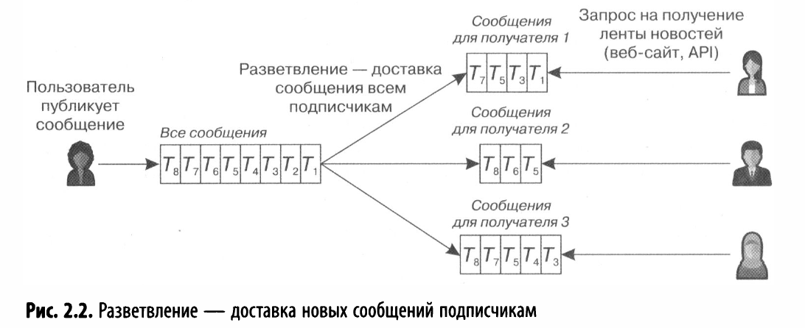
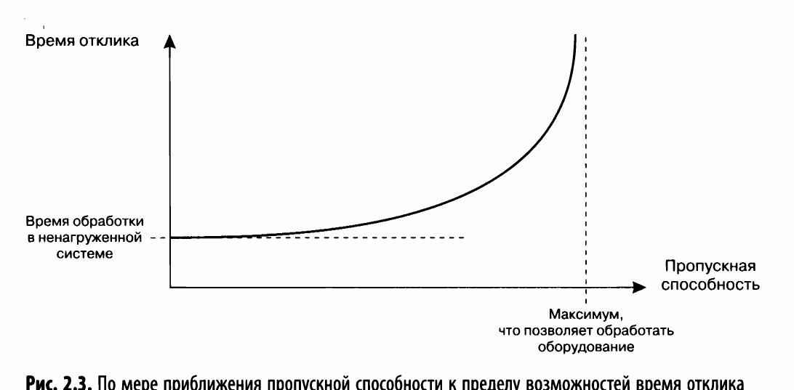
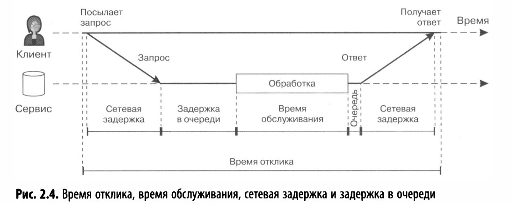
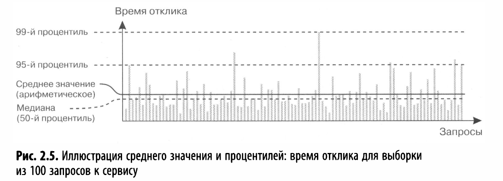
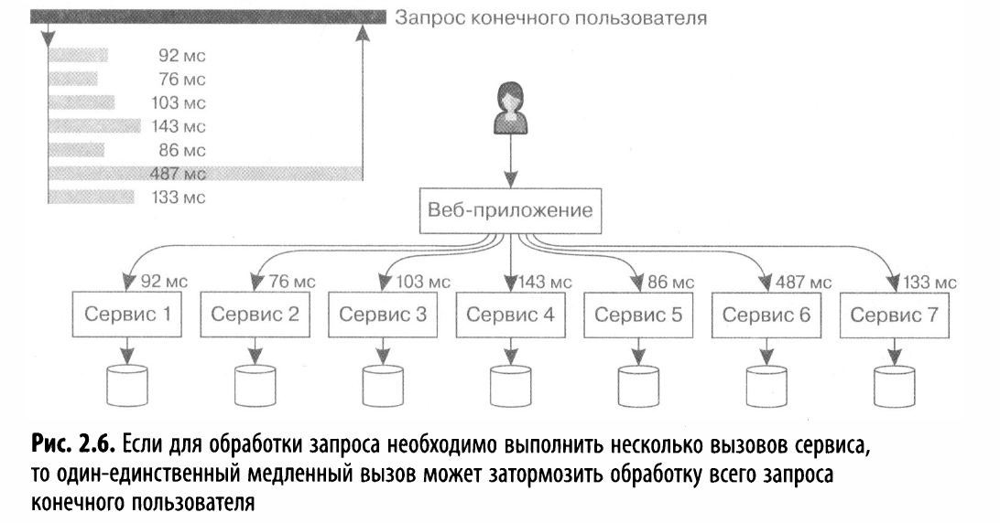

# 📘 Глава 2. Нефункциональные требования

*Ориг.: Chapter 2. Defining Nonfunctional Requirements (стр. 33–56)*

> «Интернет сделали настолько хорошо, что большинство людей считают его природным ресурсом вроде Тихого океана, а не чем-то созданным человеком. Когда в последний раз технология такого масштаба была настолько безошибочной?»
> — Алан Кэй, интервью Dr. Dobb's Journal (2012)

---

### 🔹 Вступление

- **Функциональные требования** определяют, какие экраны и кнопки должны быть и что делает каждая операция.
- **Нефункциональные требования** — это быстрота, надёжность, безопасность, простота обслуживания, соответствие законодательству. Их часто не прописывают явно, но они так же важны: слишком медленное или ненадёжное приложение можно считать несуществующим.
- В главе рассматриваются: **производительность**, **надёжность (отказоустойчивость)**, **масштабируемость** и **удобство сопровождения**. Безопасность остаётся за рамками книги.

> 🔗 **Связь.** То, что здесь — **нефункциональные требования**, в «Фундаментальном подходе к программной архитектуре» называется **архитектурными свойствами**: [Глава 4. Основные свойства архитектуры](../../fundamental-software-architecture/chapters/Глава%204.%20Основные%20свойства%20архитектуры.md). Там же — главный принцип: свойства не максимизируют все сразу, а ищут «наименее худшую» архитектуру.

---

## 1️⃣ Кейс: главная лента новостей соцсети

**Условия** (упрощённая сеть в стиле X/Twitter):

- **500 млн сообщений в день**, в среднем **5 800 сообщений/с**, в пиках — до **150 000/с**.
- Средний пользователь подписан на **200 человек** и имеет **200 подписчиков**. Разброс огромен: у знаменитостей, например Барака Обамы, больше **100 млн** подписчиков.

**Хранение:** реляционная БД с тремя таблицами — пользователи, сообщения, подписки (follows).

**Основная операция чтения** — главная лента: последние сообщения тех, на кого подписан пользователь. Реализуется SQL-запросом: `JOIN` posts/follows/users, `WHERE follower_id = current_user`, `ORDER BY timestamp DESC LIMIT 1000`.

*Рис. 2-1. Реляционная схема соцсети: пользователи, сообщения, подписки*

**Проблема опроса:**

- Сообщение должно быть видно подписчикам в течение **5 с**. Если клиент выполняет запрос каждые 5 с (**опрос, polling**), а в сети **10 млн** пользователей, получается **2 млн запросов/с**.
- Каждый запрос тяжёлый: нужно объединить сообщения **200 подписок** → **400 млн** запросов/с. И это средний случай; у пользователей с десятками тысяч подписок задача ещё тяжелее.

**Материализация лент:**

- Вместо опроса сервер сам отправляет новые сообщения подписчикам, а результат запроса вычисляется заранее и берётся из кэша.
- Для каждого пользователя хранится структура с его лентой. При публикации сообщения сервер находит всех подписчиков и добавляет сообщение в их ленты — как доставка в почтовый ящик. Клиент просто подписывается на поток добавлений в свою ленту.
- Цена — больше работы при записи. Когда один запрос порождает несколько последующих, это **разветвление (fan-out)**; коэффициент разветвления показывает, во сколько раз растёт число запросов.
- При **5 800 публикаций/с** и разветвлении **200** получается чуть больше **1 млн записей в ленты в секунду** — много, но намного меньше 400 млн.
- При всплеске публикаций доставку можно поставить в очередь: ленты обновятся с задержкой, но будут быстро загружаться, так как берутся из кэша.
- Предварительное вычисление и обновление результатов — **материализация**; кэш ленты — пример **материализованного представления**. Ускоряет чтение, но требует больше работы при записи.

*Рис. 2-2. Разветвление — доставка новых сообщений подписчикам*

**Крайние случаи:**

- Пользователь подписан на очень много активных аккаунтов: частота записей в его ленту высока, но он вряд ли читает всё, поэтому часть сообщений можно удалить из ленты.
- Знаменитость с миллионами подписчиков: пропуск публикаций недопустим. Решение — хранить сообщения знаменитостей отдельно и объединять с материализованной лентой при чтении. Даже так потребуется значительная инфраструктура.

> 🔗 **Связь.** Лента — это **производные данные** ([Глава 1. Компромиссы в архитектуре систем данных](./ГЛАВА%201%20Компромиссы%20в%20архитектуре%20систем%20данных.md)), а её материализация — та же денормализация ради чтения, что в главе 3 (CQRS и отдельные модели чтения).

---

## 2️⃣ Описание производительности

**Две основные метрики:**

- **Время отклика** — от отправки запроса до получения ответа (секунды, миллисекунды, микросекунды).
- **Пропускная способность** — число запросов или объём данных в секунду. Для заданных ресурсов есть максимум.

Для соцсети: пропускная способность — сообщений/с и записей в ленту/с; время отклика — загрузка главной страницы и время до доставки сообщения подписчикам.

**Связь метрик:** при малой нагрузке время отклика мало, с ростом нагрузки оно растёт из-за очередей; при приближении к максимуму задержки в очередях резко возрастают.

*Рис. 2-3. Когда throughput приближается к пределу, время отклика резко растёт из-за очередей*

Для пользователей важнее время отклика; пропускная способность определяет ресурсы (число серверов) и стоимость. **Масштабируемая система** — та, чья максимальная пропускная способность значительно растёт при добавлении ресурсов.

### 🔹 Врезка: перегруженная система не может восстановиться

- Система на грани перегрузки может попасть в порочный круг: длинная очередь → клиенты по тайм-ауту повторяют запросы → ещё больше запросов (**шквал повторных попыток**). Система может оставаться перегруженной даже после снижения нагрузки, до перезагрузки. Это **метастабильный сбой**.
- **Меры на клиенте:** экспоненциальное увеличение и рандомизация интервалов между повторами (**exponential backoff**); временное прекращение запросов к сервису, который вернул ошибки (**circuit breaker**); алгоритм корзины токенов (**token bucket**).
- **Меры на сервере:** превентивное отклонение запросов (**load shedding**), ответы с просьбой снизить частоту запросов (**backpressure**), алгоритмы организации очередей и балансировки нагрузки.

> 🔗 **Связь.** Это **шаблоны стабильности** из «Создания микросервисов»: тайм-ауты, повторы с паузой, переборки, автоматические выключатели — [Глава 12. Отказоустойчивость](../../building-microservices/chapters/ГЛАВА%2012%20Отказоустойчивость.md). Для очереди доставки в ленты — **паттерн Dead Letter**: не удалось обработать, кладём в DLQ, а не крутим в бесконечном повторе.

### 🔹 Задержка и время отклика

- **Время отклика** — наблюдаемое клиентом, включает все задержки.
- **Время обслуживания** — время активной обработки запроса сервисом.
- **Задержка в очереди** — ожидание на разных этапах (освобождение процессора, буфер отправки в сеть).
- **Задержка (latency)** — время, когда запрос не обрабатывается активно. **Сетевая задержка** — время перемещения запроса и ответа по сети.

*Рис. 2-4. Время отклика, время обслуживания, сетевая задержка и задержка в очереди*

### 🔹 Время отклика

- Меняется от запроса к запросу даже для одного и того же запроса. Причины: переключение контекста, потеря пакета и повторная передача TCP, пауза сборки мусора, ошибка страничного доступа с чтением с диска, вибрации в стойке.
- Главная причина изменчивости — **задержки в очереди**. Сервер обрабатывает параллельно ограниченное число заданий (например, по числу ядер), поэтому несколько медленных запросов задерживают последующие — **блокировка головы очереди**. Задержка в очереди не входит во время обслуживания, поэтому время отклика нужно измерять на стороне клиента.

### 🔹 Среднее, медиана и процентили

- Время отклика — распределение значений, а не одно число. Изменение сетевой задержки также называют **флуктуациями**.
- **Среднее** (арифметическое) удобно для оценки пределов пропускной способности, но плохо показывает типичное время: не говорит, у скольких пользователей была такая задержка.
- **Медиана (р50)** — середина отсортированного списка: например, 200 мс означает, что половина запросов быстрее, половина медленнее. Хорошая метрика типичного ожидания.
- **Высокие процентили** — р95, р99, р999. Например, р95 = 1,5 с: 95 из 100 запросов быстрее 1,5 с, 5 — 1,5 с и более.
- Верхние процентили (**хвостовые задержки**) влияют на опыт пользователей. Amazon задаёт требования для внутренних сервисов по **р999** (1 из 1000 запросов), потому что самые медленные запросы часто у клиентов с наибольшим объёмом данных — самых ценных. Оптимизация по р9999 сочтена слишком дорогой: на неё влияют случайные события вне контроля, а выгоды минимальны.

*Рис. 2-5. Среднее и перцентили: время отклика 100 запросов*

### 🔹 Врезка: влияние времени отклика на пользователя

- Получить надёжные данные сложно, часть цитируемой статистики ненадёжна.
- **Google (2006):** замедление с 400 до 900 мс — падение трафика и доходов на **20 %**. **Google (2009):** +400 мс — лишь −0,6 % поисковых запросов в день. **Bing:** +2 с времени загрузки — −4,3 % доходов от рекламы. Новых данных компании, похоже, не публикуют.
- **Akamai:** +100 мс снижает конверсию e-commerce до **7 %**. Но в том же исследовании очень быстрая загрузка тоже коррелировала с низкой конверсией (быстрее всего грузятся страницы без полезного контента, например с ошибкой 404); влияние контента и времени загрузки не разделяли, поэтому результаты практически бесполезны.
- **Yahoo** (годом позже): при разнице между быстрым и медленным откликом от 1,25 с и более число щелчков при быстром поиске выросло на **20–30 %** (с учётом качества результатов).

### 🔹 Использование метрик времени отклика

- Верхние процентили особенно важны для сервисов, вызываемых многократно при обработке одного запроса пользователя: ждать приходится самого медленного вызова, даже если вызовы параллельны. Чем больше вызовов, тем выше вероятность попасть на медленный, поэтому большинство запросов конечных пользователей оказываются медленными (**увеличение хвостового времени ожидания**).
- Процентили используются в **SLO** (целевые показатели уровня обслуживания) и **SLA** (соглашения об уровне обслуживания). Пример SLO: медиана < 200 мс, р99 < 1 с, не менее 99,9 % корректных запросов без ошибок. SLA — контракт, определяющий ответственность за невыполнение SLO (например, возврат средств). На практике определить хорошие показатели доступности для SLO и SLA непросто.

*Рис. 2-6. Один медленный бэкенд-вызов замедляет весь запрос пользователя*

### 🔹 Врезка: вычисление процентилей

- Хранить времена отклика в скользящем окне (например, 10 мин), каждую минуту вычислять медиану и процентили и строить график. В простейшем случае — хранить список и сортировать.
- Для меньших затрат — алгоритмы приближённого вычисления: **HdrHistogram**, **t-digest**, **OpenHistogram**, **DDSketch**.
- **Усреднять процентили** (для понижения разрешения или объединения данных с машин) математически бессмысленно; правильно агрегировать, складывая гистограммы.

> 🔗 **Связь.** Как превратить «р99 < 1 с» в проверяемое требование — **функции пригодности** из [Главы 6. Измерение параметров архитектурных свойств](../../fundamental-software-architecture/chapters/Глава%206.%20Измерение%20параметров%20архитектурных%20свойств.md) (пример оттуда: «время отклика API < 200 мс при 10k RPS»).

---

## 3️⃣ Надёжность и отказоустойчивость

От ПО ожидается: выполняет ожидаемую функцию; выдерживает ошибки пользователя и неожиданное использование; достаточно производительно при предполагаемых нагрузке и объёме данных; предотвращает несанкционированный доступ и злоупотребления. **Надёжность** — «продолжать работать нормально даже в случае проблем».

**Различие терминов:**

- **Сбой (fault)** — часть системы перестала работать должным образом (диск, компьютер, внешний сервис).
- **Отказ (failure)** — система в целом перестала предоставлять услугу (нарушен SLO).
- Это одно и то же на разных уровнях: отказ диска для системы из многих дисков — лишь сбой, который можно компенсировать копией данных.

**Отказоустойчивость** — система продолжает предоставлять услуги несмотря на некоторые отказы. Часть, без которой система не работает, — **единая точка отказа (SPOF)**.

Пример для соцсети: если машина, обновляющая ленты, вышла из строя, её задачу должна выполнить другая машина без пропуска и без дублирования сообщений (**«точно один раз»**, глава 12).

Отказоустойчивость всегда ограничена определёнными типами отказов (например, не более двух дисков или одного из трёх узлов). Защита от любого числа сбоев бессмысленна.

**Внедрение сбоев:** имеет смысл умышленно вызывать сбои (например, завершать случайные процессы без предупреждения). Многие критические ошибки возникают из-за недостаточной обработки ошибок; так механизмы устойчивости постоянно тестируются. Отдельная дисциплина — **хаос-инженерия**.

Обычно лучше мириться с ошибками, чем предотвращать, но иногда предупреждение лучше лечения — например, для безопасности (если данные скомпрометированы, исправить нельзя). Книга в основном о сбоях, допускающих лечение.

### 🔹 Аппаратные сбои

- Магнитные диски: **2–5 %** выходят из строя в год; в кластере из 10 000 дисков ожидается в среднем один отказ в день. Диски надёжнее, но частота остаётся значительной.
- **SSD:** 0,5–1,0 % в год; мелкие битовые ошибки исправляются, но неисправимые ошибки возникают в среднем раз в год на накопитель, даже на новых, — выше, чем у HDD.
- Блоки питания, RAID-контроллеры, модули памяти тоже отказывают, но реже дисков.
- Примерно на **1 из 1000** машин одно из ядер CPU иногда выдаёт неверный результат (вероятно, производственные дефекты) — чаще программа просто возвращает неверный результат.
- Память: повреждения из-за космических лучей или физических дефектов; даже с ECC более **1 %** машин за год сталкиваются с неисправимой ошибкой. Некоторые паттерны доступа к памяти с высокой вероятностью меняют биты.
- Целый ЦОД может стать недоступным (отключение электричества, конфигурация сети) или разрушенным (пожар, наводнение, землетрясение). Солнечные бури могут вызывать токи в длинных проводах и повреждать электросети и подводные кабели. Такие события редки, но последствия катастрофичны, если сервис не переживает потерю ЦОД.
- В больших системах аппаратные сбои достаточно часты, чтобы считаться частью нормальной работы.

> 🔗 **Связь.** Тот же тезис — «в масштабе сбои становятся статистической вероятностью» — и вывод «много дешёвых машин вместо дорогих»: [Глава 12. Отказоустойчивость](../../building-microservices/chapters/ГЛАВА%2012%20Отказоустойчивость.md) («Создание микросервисов», раздел «Сбои повсюду»). Там же пример Google: диски крепят липучками, а не винтами, чтобы менять их быстро.

**Резервирование оборудования:** RAID, два блока питания, «горячая» замена процессоров, аккумуляторы и дизель-генераторы в ЦОД. Позволяет машине работать годами. Эффективно при независимых отказах, но на практике они значительно коррелируют: стойка или ЦОД целиком остаются недоступными чаще, чем хотелось бы.

Распределённые системы дают дополнительные преимущества (переживание полного отказа ЦОД). Поэтому облачные системы меньше внимания уделяют надёжности отдельных машин и обрабатывают сбои на программном уровне. Облачные провайдеры используют **зоны доступности** (ресурсы в одной зоне вероятнее откажут одновременно). Методы книги (главы 6, 10 и др.) обеспечивают устойчивость к потере машин, стоек, зон: функции вышедшей из строя машины берёт на себя машина в другом ЦОД.

Эксплуатационное преимущество: многоузловую систему можно обновлять **непрерывным обновлением (rolling upgrade)** — по одному узлу, не влияя на пользователей (глава 5); односерверная требует планового простоя.

### 🔹 Программные сбои

- Аппаратные сбои в основном случайны и независимы; программные часто сильно **коррелированы** (на многих узлах то же ПО с теми же ошибками), труднее предвидеть и вызывают больше системных отказов.
- Примеры:
  - ошибка, отключающая все узлы при определённых обстоятельствах (секунда координации 30 июня 2012 года, ошибка ядра Linux, вызвала зависание множества Java-приложений; ошибка прошивки — SSD определённых моделей выходят из строя ровно через 32 768 ч работы, менее 4 лет, данные невосстановимы);
  - процесс, исчерпавший общий ресурс (CPU, память, диск, сеть, потоки) — ошибка клиентской библиотеки может породить больше запросов, чем ожидалось;
  - зависимый сервис замедляется, не отвечает или возвращает некорректные ответы;
  - взаимодействие систем порождает поведение, не наблюдавшееся при изолированном тестировании;
  - каскадные сбои.
- Такие ошибки долго неактивны, пока не сработают в необычных обстоятельствах: приложение делает допущение об окружении, которое в какой-то момент перестаёт быть верным.
- Быстрого решения нет. Помогают: тщательное обдумывание допущений и взаимодействий, всестороннее тестирование, изоляция процессов, возможность перезапуска после фатального сбоя, исключение петель обратной связи (шквал повторных попыток), измерение, мониторинг и анализ поведения в эксплуатации.

### 🔹 Человеческий фактор

- Люди проектируют, создают и эксплуатируют системы; творческий подход и адаптивность ведут и к непредсказуемости, и к ошибкам. По одному исследованию крупных интернет-сервисов, основной причиной перебоев были ошибки конфигурации операторами, а сбои оборудования играли роль лишь в **10–25 %** случаев.
- Обвинять людей непродуктивно: «человеческий фактор» — симптом проблемы в социотехнической системе.
- **Технические меры:** тщательное тестирование (рукописные тесты и тесты свойств на случайных данных), механизмы отката конфигурации, постоянное внедрение нового кода, детальный мониторинг и наблюдаемость, интерфейсы, поощряющие правильные действия и препятствующие неправильным.
- Всё это требует времени и денег; организации часто выбирают функции вместо тестов, а потом обвиняют совершившего ошибку, хотя проблема в приоритетах организации.
- Растёт культура **анализа причин инцидентов без поиска виновных**: причастных поощряют делиться подробностями без угрозы наказания, чтобы другие учились. Это может привести к изменению приоритетов бизнеса, инвестициям, изменению системы поощрений, вниманию руководства к системной проблеме.
- При расследовании следует с подозрением относиться к упрощённым ответам («Боб должен был быть осторожнее», «нужно переписать сервис на Haskell» — оба непродуктивны). Руководству стоит узнать подробности работы системы от тех, кто с ней работает.

> 🔗 **Связь.** Техническая страховка от ошибок человека — откат и развёртывание без простоя: [Глава 8. Развертывание](../../building-microservices/chapters/ГЛАВА%208%20Развертывание.md) («Создание микросервисов»).

### 🔹 Врезка: насколько важна надёжность

- Нужна не только в атомной энергетике и авиации: ошибки в коммерческих приложениях ведут к потерям производительности и юридическим рискам; простои интернет-магазинов — к убыткам и ущербу репутации.
- Временный сбой на минуты или часы часто допустим, но необратимая потеря или повреждение данных катастрофичны (пример: родители, хранящие все фото и видео детей в вашем приложении).
- **Post Office Horizon:** с 1999 по 2019 год сотни сотрудников почтовых отделений в Великобритании были осуждены за кражу или мошенничество из-за недостач в бухгалтерском ПО; значительная часть недостач оказалась вызвана ошибками ПО, многие приговоры отменены. Это крупнейшая судебная ошибка в британской истории; её породило предположение английского права, что компьютеры работают правильно, если нет доказательств обратного. Люди оказались в тюрьме, обанкротились, некоторые покончили с собой.
- Иногда можно сознательно пожертвовать надёжностью ради снижения стоимости (прототип для нового рынка), но с осторожностью и помня о последствиях.

---

## 4️⃣ Масштабируемость

**Масштабируемость** — способность системы справляться с возросшей нагрузкой (рост числа пользователей, объёма данных).

- Для нового продукта с малым числом пользователей главная цель — простота и гибкость; забота о гипотетическом масштабировании — в лучшем случае пустая трата усилий и преждевременная оптимизация, в худшем — негибкая конструкция.
- Масштабируемость не одномерна: фразы «Х масштабируема» или «Y немасштабируема» бессмысленны. Обсуждение масштабирования — это вопросы: какие варианты, если система вырастет определённым образом; как нарастить ресурсы при росте нагрузки; когда будет достигнут предел текущей архитектуры при текущих прогнозах.

> 🔗 **Связь.** Практика — **четыре оси масштабирования** (вертикальное, горизонтальное дублирование, разделение данных, функциональная декомпозиция) в [Главе 13. Масштабирование](../../building-microservices/chapters/ГЛАВА%2013%20Масштабирование.md) («Создание микросервисов»).

### 🔹 Изучение нагрузки

- Сначала нужно изучить текущую нагрузку. Чаще всего это пропускная способность (запросы/с, ГБ новых данных в день, заказы в час), иногда пиковое значение (одновременно подключённые пользователи).
- Влияют и другие характеристики: соотношение чтений и записей, коэффициент попадания в кэш, число элементов данных на пользователя (подписчики). Важно может быть среднее или узкое место из-за небольшого числа экстремальных случаев.
- Два вопроса о росте: как изменится производительность при росте нагрузки и неизменных ресурсах; насколько нужно увеличить ресурсы, чтобы производительность осталась прежней.
- Цель обычно — уложиться в SLA и минимизировать затраты. Разное оборудование эффективно по-разному, и это меняется со временем.
- **Линейная масштабируемость:** удвоение ресурсов позволяет обрабатывать вдвое большую нагрузку при той же производительности — хороший признак. Иногда возможно и с меньшим ростом ресурсов (эффект масштаба, лучшее распределение пиков). Чаще затраты растут быстрее линейных (например, запись требует больше работы при большем объёме данных).

### 🔹 Архитектуры: общая память, общий диск, без общих ресурсов

- **Вертикальное масштабирование (масштабирование вверх)** — более мощная машина (больше ядер, ОЗУ, диска). Параллелизм на одной машине — процессы или потоки; это **архитектура с общей памятью**. Недостаток: стоимость растёт быстрее линейной, а из-за узких мест вдвое мощная машина не обработает вдвое большую нагрузку.
- **Архитектура с общим диском** — несколько машин со своими процессорами и ОЗУ, данные на общем массиве дисков через быструю сеть (**NAS** или **SAN**). Традиционно для локальных хранилищ данных; проблемы параллелизма ограничивают масштабируемость.
- **Архитектура без общих ресурсов (горизонтальное масштабирование, масштабирование наружу)** — распределённая система узлов, у каждого свои процессоры, ОЗУ и диски; координация на уровне ПО через обычную сеть. Преимущества: потенциально линейная масштабируемость, любое оборудование с лучшим соотношением цена/производительность (особенно в облаке), проще менять ресурсы под нагрузку, большая отказоустойчивость за счёт нескольких ЦОД и регионов. Недостатки: явный **шардинг** (глава 7) и все сложности распределённых систем (глава 9).
- Некоторые облачные БД разделяют хранение и выполнение транзакций: несколько вычислительных узлов используют один сервис хранения. Похоже на общий диск, но без его проблем масштабируемости; вместо файловой системы (NAS) или блочного устройства (SAN) — специализированный API.

### 🔹 Принципы масштабируемости

- Архитектура больших систем узкоспециализированна, универсального «рецепта» нет. Система на 100 000 запросов/с по 1 Кбайт и система на 3 запроса/мин по 2 Гбайт выглядят совершенно по-разному при той же пропускной способности 100 Мбайт/с.
- Архитектура под один уровень нагрузки вряд ли справится с нагрузкой в десять раз большей; в быстрорастущем сервисе архитектуру, возможно, придётся пересматривать при каждом росте на порядок. Планировать масштабирование более чем на порядок вперёд обычно не стоит.
- Общий принцип: разбивать систему на мелкие, в основном независимые компоненты (микросервисы, шардинг, потоковая обработка, архитектура без общих ресурсов). Сложность — определить, где проходит граница.
- Не усложнять без необходимости: если хватает БД на одной машине, лучше она, чем распределённая система. Автомасштабирование хорошо, но при предсказуемой нагрузке ручное может дать меньше неожиданностей. Система из пяти сервисов проще, чем из пятидесяти. Хорошие архитектуры — прагматичное сочетание подходов.

> 🔗 **Связь.** «Где провести границу» — это выбор стиля: [ГЛАВА 18. Выбор подходящего архитектурного стиля](../../fundamental-software-architecture/chapters/ГЛАВА%2018%20Выбор%20подходящего%20архитектурного%20стиля.md) (монолит или распределённая система — по контексту, а не по моде) и [ГЛАВА 17. Архитектура микросервисов](../../fundamental-software-architecture/chapters/ГЛАВА%2017%20Архитектура%20микросервисов.md).

---

## 5️⃣ Удобство сопровождения

- ПО не изнашивается, но меняются требования и среда (зависимости, платформа), из-за чего возникают ошибки.
- Большая часть затрат приходится на сопровождение: исправление ошибок, поддержание работоспособности, расследование отказов, адаптация к новым платформам, новые сценарии, возврат технического долга, новые возможности.
- Сопровождение сложно, особенно устаревших систем: устаревшие технологии (мейнфреймы, COBOL), потеря институционального знания при уходе сотрудников, чужие ошибки. Это не только техническая, но и человеческая проблема.
- Любая достаточно ценная система однажды станет устаревшей, поэтому нужно проектировать с учётом сопровождения.

**Три принципа:**

- **Удобство эксплуатации** — облегчает обслуживающему персоналу поддержание работы системы.
- **Простота** — облегчает новым инженерам понимание (известные паттерны, отказ от излишних усложнений).
- **Возможность развития** — упрощает внесение изменений и адаптацию к непредвиденным сценариям.

### 🔹 Удобство эксплуатации

- Качественная эксплуатация может обойти ограничения плохого ПО, а некачественная сделает ненадёжным даже хорошее.
- Ручное обслуживание тысяч машин слишком дорого, нужна автоматизация, но она палка о двух концах: нестандартные ситуации требуют ручного вмешательства, и чем выше автоматизация, тем квалифицированнее нужны специалисты; к тому же сложнее устранять проблемы. Оптимальный уровень зависит от приложения и организации.
- Что система может делать для облегчения эксплуатации:
  - инструменты мониторинга и наблюдаемость;
  - независимость от отдельных машин (отключение для обслуживания без остановки системы);
  - качественная документация и понятная операционная модель («если я выполню действие Х, произойдёт Y»);
  - разумное поведение по умолчанию с возможностью переопределения администратором;
  - самовосстановление, но с возможностью ручного управления;
  - предсказуемое поведение, минимум неожиданностей.

> 🔗 **Связь.** Мониторинг, логи, трассировка и как из них делать выводы — [Глава 10. От мониторинга к наблюдаемости](../../building-microservices/chapters/ГЛАВА%2010%20От%20мониторинга%20к%20наблюдаемости.md) («Создание микросервисов»).

### 🔹 Простота: регулируем сложность

- Небольшие проекты могут быть простыми и выразительными, но по мере роста становятся сложными (**большой ком грязи**). Сложность замедляет работу, увеличивает стоимость сопровождения, ведёт к превышению бюджетов и срыву сроков, повышает риск ошибок при изменениях (скрытые допущения, непреднамеренные последствия). Простота — основная цель.
- Простота часто субъективна, объективного стандарта нет (простая реализация за обширным интерфейсом или сложная за простым — что проще?).
- Приём: делить сложность на **существенную** (присуща предметной области) и **случайную** (из-за ограничений инструментов). Но граница смещается по мере развития инструментов.
- Лучший инструмент управления сложностью — **абстракция**: скрывает детали за понятным фасадом и переиспользуется в разных приложениях, что эффективнее и улучшает качество по мере усовершенствования компонента. Примеры: высокоуровневые языки (скрывают машинный код, регистры, системные вызовы); SQL (скрывает структуры данных на диске и в памяти, конкурентные запросы, несогласованность после сбоев).
- Абстракции в коде создают паттерны проектирования и DDD. Книга посвящена более универсальным абстракциям (транзакции, индексы, журналы событий), которые дают базу и для DDD.

> 🔗 **Связь.** Сложность предметной области и границы моделей — [ГЛАВА 3. Как осмыслить сложность предметной области](../../learning-domain-driver-design/chapters/ГЛАВА%203%20Как%20осмыслить%20сложность%20предметной%20области.md) (DDD).

### 🔹 Возможность развития: облегчаем внесение изменений

- Требования почти наверняка будут меняться: новые факты, сценарии, коммерческие приоритеты, требования пользователей, платформы, правовые нормы, архитектурные изменения при росте.
- Организационно: гибкие (**agile**) модели; технические инструменты — **TDD** и **рефакторинг**. Книга ищет гибкость на уровне системы из нескольких приложений и сервисов.
- Простые и слабосвязанные системы модифицировать легче. Для гибкости на уровне системы данных используется термин **«способность развиваться» (evolvability)**.
- Главный фактор, затрудняющий изменения, — **необратимость** (например, переход на другую БД без возможности вернуться). Необратимые действия нужно выполнять осторожно; минимизация необратимости повышает гибкость.

> 🔗 **Связь.** Эволюция проектных решений — [ГЛАВА 11. Эволюция проектных решений](../../learning-domain-driver-design/chapters/ГЛАВА%2011%20Эволюция%20проектных%20решений.md) (DDD) и [Глава 16. Эволюционный архитектор](../../building-microservices/chapters/ГЛАВА%2016%20Эволюционный%20архитектор.md); фиксация компромиссов и цена необратимых решений — [ГЛАВА 19. Архитектурные решения](../../fundamental-software-architecture/chapters/ГЛАВА%2019%20Архитектурные%20решения.md) (ADR).

---

## 🧾 Итоги главы

- Рассмотрены нефункциональные требования: **производительность**, **надёжность**, **масштабируемость**, **удобство сопровождения**.
- Пример ленты новостей иллюстрирует проблемы масштабирования. Производительность измеряют **процентилями времени отклика**, нагрузку — **пропускной способностью**; эти метрики входят в **SLA**.
- **Масштабируемость** — сохранение высокой производительности при росте нагрузки; общий принцип — разделение на независимые части.
- Для надёжности применяют **отказоустойчивость**: система работает, даже если откажет диск, машина или другой сервис. Программные сбои сложнее аппаратных, так как часто коррелированы. Также нужна устойчивость к человеческим ошибкам и культура анализа инцидентов без поиска виновных.
- **Удобство сопровождения** включает эксплуатацию, управление сложностью и возможность развития. Простого ответа нет, но помогает построение приложений из известных строительных блоков с полезными абстракциями; их книга рассмотрит далее.

---

## 🔗 Связи

| Тема главы | Где подробнее |
|---|---|
| Нефункциональные требования = архитектурные свойства, компромиссы | [Глава 4. Основные свойства архитектуры](../../fundamental-software-architecture/chapters/Глава%204.%20Основные%20свойства%20архитектуры.md) |
| Метрики и проверяемые требования (fitness functions) | [Глава 6. Измерение параметров архитектурных свойств](../../fundamental-software-architecture/chapters/Глава%206.%20Измерение%20параметров%20архитектурных%20свойств.md) |
| Материализация, производные данные, денормализация | [Глава 1. Компромиссы в архитектуре систем данных](./ГЛАВА%201%20Компромиссы%20в%20архитектуре%20систем%20данных.md); глава 3 «Модели данных и языки запросов» (в конспекте ещё не готова) |
| Тайм-ауты, повторы, переборки, автоматические выключатели | [Глава 12. Отказоустойчивость](../../building-microservices/chapters/ГЛАВА%2012%20Отказоустойчивость.md) |
| Наблюдаемость и эксплуатация | [Глава 10. От мониторинга к наблюдаемости](../../building-microservices/chapters/ГЛАВА%2010%20От%20мониторинга%20к%20наблюдаемости.md), [Глава 8. Развертывание](../../building-microservices/chapters/ГЛАВА%208%20Развертывание.md) |
| Четыре оси масштабирования | [Глава 13. Масштабирование](../../building-microservices/chapters/ГЛАВА%2013%20Масштабирование.md) |
| Монолит или распределённая система, границы сервисов | [ГЛАВА 17. Архитектура микросервисов](../../fundamental-software-architecture/chapters/ГЛАВА%2017%20Архитектура%20микросервисов.md), [ГЛАВА 18. Выбор подходящего архитектурного стиля](../../fundamental-software-architecture/chapters/ГЛАВА%2018%20Выбор%20подходящего%20архитектурного%20стиля.md) |
| Сложность предметной области и границы моделей | [ГЛАВА 3. Как осмыслить сложность предметной области](../../learning-domain-driver-design/chapters/ГЛАВА%203%20Как%20осмыслить%20сложность%20предметной%20области.md) |
| Эволюционируемость и необратимость | [ГЛАВА 11. Эволюция проектных решений](../../learning-domain-driver-design/chapters/ГЛАВА%2011%20Эволюция%20проектных%20решений.md), [Глава 16. Эволюционный архитектор](../../building-microservices/chapters/ГЛАВА%2016%20Эволюционный%20архитектор.md), [ГЛАВА 19. Архитектурные решения](../../fundamental-software-architecture/chapters/ГЛАВА%2019%20Архитектурные%20решения.md) |
| Доп. материалы | Redis (кэширование), паттерн Dead Letter (очереди и повторы) |

**Дальше в книге:** главы 6 (репликация), 7 (шардирование), 8 (транзакции), 9–10 (распределённые системы и консенсус), 12 (потоковая обработка и «ровно один раз»), 14 (этика и право).
