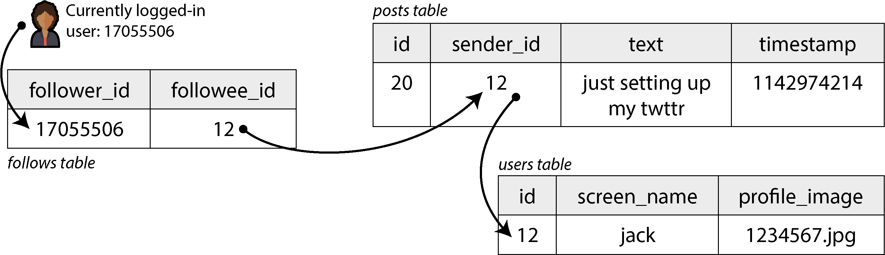
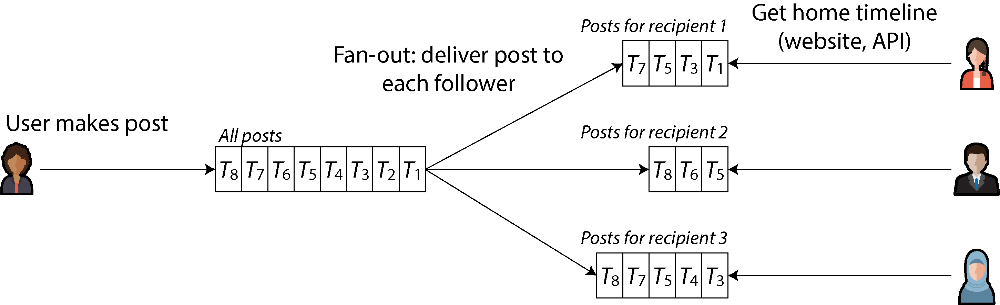
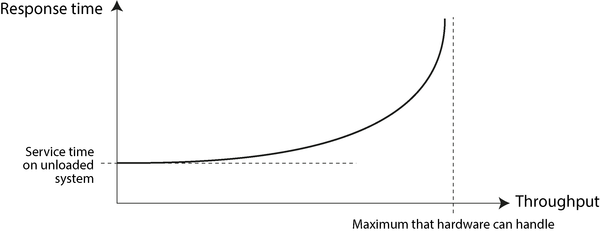
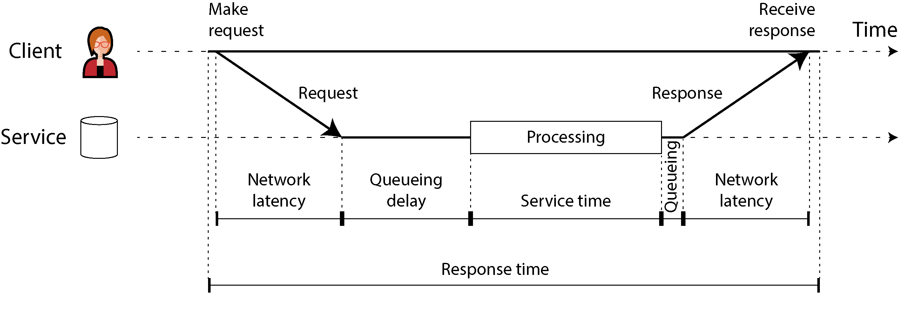
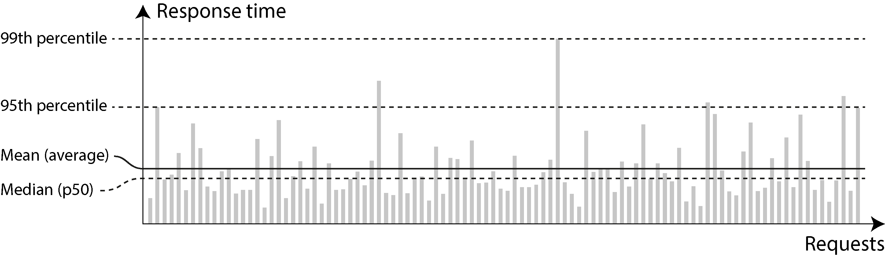
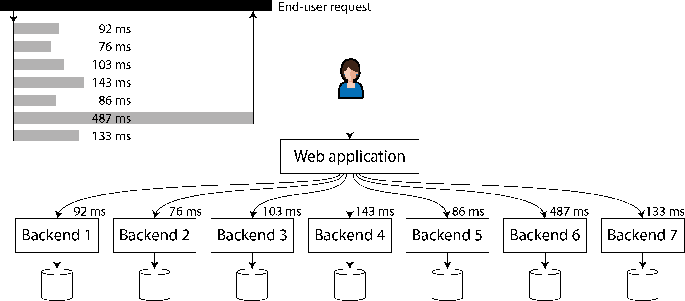

# 📘 Глава 2. Нефункциональные требования

*Ориг.: Chapter 2. Defining Nonfunctional Requirements (стр. 33–56 + список литературы до стр. 64)*

> «Интернет сделали настолько хорошо, что большинство людей считают его природным ресурсом вроде Тихого океана, а не чем-то созданным человеком. Когда в последний раз технология такого масштаба была настолько безошибочной?»
> — Алан Кэй, интервью Dr. Dobb's Journal (2012)

---

### 🔹 Вступление

- Когда строишь приложение, тобой движет **список требований**. Вверху списка обычно **функциональность**: какие экраны и кнопки нужны, что должна делать каждая операция. Это **функциональные требования**.
- Кроме них есть **нефункциональные требования**: приложение должно быть **быстрым, надёжным, безопасным, соответствовать закону и легко поддерживаться**.
- Их часто **не записывают явно**, потому что они кажутся очевидными. Но они **так же важны**, как функциональность: невыносимо медленное или ненадёжное приложение всё равно что не существует.
- Многие нефункциональные требования (например, **безопасность**) выходят за рамки книги. Глава разбирает несколько и помогает сформулировать их для своих систем:
  1. как **определить и измерить производительность** системы;
  2. что значит **надёжность** сервиса — продолжать работать правильно, **даже когда что-то идёт не так**;
  3. как сделать систему **масштабируемой** — эффективно добавлять вычислительные мощности при росте нагрузки;
  4. как облегчить **поддержку** системы в долгосрочной перспективе.
- Термины из этой главы понадобятся в следующих. Чтобы абстрактные определения не были сухими, глава начинается с **кейса соцсети**.

> Связь: то же самое в «Фундаментальном подходе к программной архитектуре» называется **архитектурными характеристиками** — [Глава 4. Основные свойства архитектуры](../../fundamental-software-architecture/chapters/Глава%204.%20Основные%20свойства%20архитектуры.md), [Глава 6. Измерение параметров архитектурных свойств](../../fundamental-software-architecture/chapters/Глава%206.%20Измерение%20параметров%20архитектурных%20свойств.md).

---

## 1️⃣ Кейс: домашние ленты в соцсети

- Задача: реализовать соцсеть в стиле **X (бывший Twitter)** — пользователи публикуют посты и подписываются друг на друга. Это **сильное упрощение** реального устройства, но оно хорошо показывает проблемы больших систем.
- Исходные цифры:
  - **500 млн постов в день** ≈ **5 800 постов/с** в среднем; в пиках — до **150 000 постов/с**;
  - в среднем пользователь подписан на **200 человек** и имеет **200 подписчиков**. Разброс огромный: у большинства горстка подписчиков, у знаменитостей вроде **Барака Обамы — больше 100 млн**.

### 🔹 Пользователи, посты и подписки
- Все данные лежат в **реляционной БД**: таблица пользователей, таблица постов, таблица подписок (follows).


*Рис. 2-1. Реляционная схема соцсети: таблицы подписок, постов и пользователей*

- Главная операция чтения — **домашняя лента (home timeline)**: свежие посты тех, на кого подписан пользователь (рекламу и рекомендации для простоты игнорируем).
- Запрос:

```sql
SELECT posts.*, users.* FROM posts
  JOIN follows ON posts.sender_id = follows.followee_id
  JOIN users   ON posts.sender_id = users.id
  WHERE follows.follower_id = current_user
  ORDER BY posts.timestamp DESC
  LIMIT 1000
```

- БД по таблице follows находит всех, на кого подписан `current_user`, ищет их свежие посты и сортирует по времени, оставляя **1 000 последних**.
- Посты должны быть своевременными: пусть подписчики видят новый пост **в течение 5 секунд**.
- Вариант «в лоб» — клиент повторяет запрос каждые 5 секунд, пока пользователь онлайн (**polling**). При **10 млн пользователей онлайн** это **2 млн запросов/с**.
- Запрос ещё и **дорогой**: при 200 подписках нужно достать посты каждого из 200 и слить списки → 2 млн × 200 = **400 млн поисков в секунду**. И это средний случай: кто-то подписан на десятки тысяч аккаунтов, для них запрос очень дорогой и его трудно ускорить.

### 🔹 Материализация и обновление лент
Как сделать лучше:
1. Вместо polling сервер сам **проталкивает (push)** новые посты подписчикам, которые сейчас онлайн.
2. **Предвычислить** результат запроса, чтобы ленту отдавать **из кэша**.

- Для каждого пользователя храним структуру с его домашней лентой. Когда кто-то публикует пост, находим всех его подписчиков и **вставляем пост в ленту каждого** — как письмо в почтовый ящик.
- При входе пользователь просто получает готовую ленту, а для уведомлений клиент **подписывается на поток** постов, добавляемых в его ленту.
- Минус: теперь **больше работы на каждой публикации** — ленты стали **производными данными**, которые надо обновлять.
- **Fan-out (веерная рассылка)** — когда один исходный запрос порождает несколько нижестоящих; так называют и **коэффициент**, во сколько раз растёт число запросов.


*Рис. 2-2. Fan-out: новый пост доставляется в ленту каждого подписчика*


Цифры:
- 5 800 постов/с × fan-out 200 ≈ **чуть больше 1 млн записей в ленты в секунду**. Много, но **несравнимо меньше** 400 млн поисков/с.
- При всплеске постов доставку в ленты можно **поставить в очередь** и смириться, что посты появятся у подписчиков чуть позже. Ленты при этом всё равно **грузятся быстро** — из кэша.

**Материализация** — предвычисление и обновление результатов запроса. Кэш лент — пример **материализованного представления (materialized view)** (подробнее в следующих главах).
- Материализованное представление **ускоряет чтение**, но **добавляет работы на запись**.
- Для большинства пользователей цена записи скромная, но есть **крайние случаи**:
  - Пользователь подписан на **очень много активных аккаунтов** → высокая частота записи в его ленту. Но он всё равно не читает всё, поэтому **часть записей можно просто отбросить** и показывать выборку постов (так делает Bluesky — «lossy timelines»).
  - **Знаменитость** с миллионами подписчиков публикует пост → надо вставить его в миллионы лент. Отбрасывать тут **нельзя**. Решение — **обрабатывать посты знаменитостей отдельно**: хранить их отдельно и **подмешивать в материализованную ленту при чтении**. Даже с такими оптимизациями обслуживание знаменитостей может требовать **много инфраструктуры** (в 2010 году писали, что 3% серверов Twitter работали на Джастина Бибера).

---

## 2️⃣ Описание производительности

Две главные метрики:
- **Время отклика (response time)** — сколько прошло от момента запроса пользователя до получения ответа. Измеряется в секундах (мс, мкс).
- **Пропускная способность (throughput)** — сколько запросов или какой объём данных система обрабатывает **в секунду**. Для заданных ресурсов есть **максимум**. Единица — «что-то в секунду».

В кейсе: «постов в секунду» и «записей в ленты в секунду» — **throughput**; «время загрузки ленты» и «время до доставки поста подписчикам» — **время отклика**.

- Метрики связаны: при низкой нагрузке время отклика маленькое, с ростом нагрузки оно растёт. Причина — **очереди**: запрос приходит на загруженную систему, CPU занят предыдущим, новый **ждёт**. Когда throughput приближается к пределу железа, задержки в очереди **резко растут** (рис. 2-3).


*Рис. 2-3. Когда throughput приближается к пределу, время отклика резко растёт из-за очередей*


### 🔹 Врезка: когда перегруженная система не восстанавливается
- Система у предела может войти в **порочный круг**: становится менее эффективной → ещё больше перегружается.
- Пример: длинная очередь → время отклика растёт → клиенты ловят **таймаут и повторяют запросы** → запросов ещё больше. Это **шторм повторов (retry storm)**.
- Даже когда нагрузка спадает, система может **остаться перегруженной**, пока её не перезагрузят. Это **метастабильный отказ (metastable failure)** — причина серьёзных аварий в проде.
- Как защититься:
  - на клиенте — увеличивать и **рандомизировать паузы** между повторами (**exponential backoff**);
  - временно **не слать запросы** сервису, который недавно отвечал ошибками или таймаутами (**circuit breaker**, алгоритм **token bucket**);
  - на сервере — заранее **отклонять запросы** при приближении к перегрузке (**load shedding**) или просить клиентов **притормозить** (**backpressure**);
  - важен и выбор алгоритмов **очередей и балансировки нагрузки**.

- Пользователей больше всего волнует **время отклика**, а **throughput** определяет нужные ресурсы (сколько серверов) и значит **стоимость**.
- Если throughput вырастет выше возможностей текущего железа, мощности надо расширять. Система **масштабируема**, если её максимальный throughput можно **заметно увеличить, добавив ресурсы**.

### 🔹 Задержка и время отклика
«Latency» и «response time» часто путают; в книге термины такие (рис. 2-4):
- **Время отклика (response time)** — то, что видит **клиент**; включает все задержки в любом месте системы.
- **Время обслуживания (service time)** — сколько сервис **активно обрабатывает** запрос.
- **Задержки в очереди (queueing delays)** — могут возникать в разных точках: запрос ждёт свободный CPU; пакет ответа ждёт в буфере, пока другие задачи на машине забивают сетевой интерфейс.
- **Задержка (latency)** — общее название для времени, когда запрос **не обрабатывается активно**, то есть «латентен». **Сетевая задержка** — время, которое запрос и ответ проводят в сети.


*Рис. 2-4. Время отклика, время обслуживания, сетевая задержка и задержка в очереди*


- Время отклика **сильно скачет** даже для одинаковых запросов. Случайные задержки дают: переключение контекста на фоновый процесс, потеря пакета и повторная передача TCP, **пауза сборщика мусора**, page fault с чтением с диска, даже **механическая вибрация в стойке** (подробнее — «Таймауты и неограниченные задержки», глава 9).
- Большая часть разброса — **задержки в очереди**. Сервер обрабатывает параллельно немного задач (ограничено числом ядер), поэтому **несколько медленных запросов задерживают все последующие** — **блокировка в начале очереди (head-of-line blocking)**. Даже быстрые запросы клиент увидит медленными.
- Время в очереди **не входит в service time**, поэтому время отклика важно **измерять на стороне клиента**.

### 🔹 Среднее, медиана и перцентили
- Время отклика — не одно число, а **распределение**. Большинство запросов быстрые, но бывают **выбросы**. Разброс сетевой задержки называют **джиттером (jitter)**.
- **Среднее (арифметическое)** полезно для оценки пределов throughput, но плохо показывает «типичное» время: не говорит, **сколько пользователей** реально столкнулись с такой задержкой.
- Лучше **перцентили**. Сортируем времена от быстрых к медленным:
  - **медиана** — середина. Медиана 200 мс → половина запросов быстрее 200 мс, половина дольше. Это **50-й перцентиль, p50** — хорошо показывает, сколько обычно ждут пользователи;
  - чтобы понять, насколько плохи выбросы, смотрят **p95, p99, p999**. p95 = 1,5 с → 95 из 100 запросов быстрее 1,5 с, 5 из 100 — 1,5 с и дольше.


*Рис. 2-5. Среднее и перцентили: время отклика 100 запросов*

- Высокие перцентили = **хвостовые задержки (tail latencies)**. Они прямо влияют на опыт пользователей.
  - **Amazon** задаёт требования к внутренним сервисам по **p999**, хотя это 1 запрос из 1 000. Самые медленные запросы часто у клиентов с **большим количеством данных** — они много покупали, то есть **самые ценные клиенты**.
  - Оптимизировать **p9999** Amazon счёл **слишком дорогим**: очень высокие перцентили легко портят случайные события вне твоего контроля, а выгода убывает.

### 🔹 Врезка: как время отклика влияет на пользователей
- Очевидно, что быстрый сервис лучше медленного, но **надёжных данных** о влиянии задержки на поведение **удивительно мало**.
- Часто цитируемая статистика ненадёжна:
  - Google, 2006: замедление выдачи с 400 до 900 мс → **−20% трафика и выручки**;
  - Google, 2009: +400 мс → всего **−0,6% поисков в день**; Bing в том же году: +2 с → **−4,3% выручки от рекламы**. Новых публичных данных от них нет.
  - Akamai: +100 мс → конверсия интернет-магазинов **до −7%**. Но там же видно, что **очень быстрые страницы тоже связаны с низкой конверсией** — быстрее всего грузятся страницы без полезного контента (например, 404). Влияние контента и скорости не разделили → результаты, скорее всего, **ничего не значат**.
  - Исследование Yahoo с контролем качества выдачи: при разнице **от 1,25 с** быстрые поиски получают **на 20–30% больше кликов**.

### 🔹 Использование метрик времени отклика
- Высокие перцентили особенно важны для бэкенд-сервисов, которые вызываются **несколько раз** ради одного запроса пользователя. Даже при параллельных вызовах ждать приходится **самый медленный** (рис. 2-6).
- Чем больше бэкенд-вызовов в одном запросе, тем выше шанс поймать медленный → большая доля пользовательских запросов медленная. Это **усиление хвостовой задержки (tail latency amplification)**.


*Рис. 2-6. Один медленный бэкенд-вызов замедляет весь запрос пользователя*


**SLO и SLA:**
- Перцентили часто используют в **SLO (service level objectives)** и **SLA (service level agreements)** — так задают ожидаемую производительность и доступность.
- Пример SLO: медиана **< 200 мс**, p99 **< 1 с**, и **не меньше 99,9%** валидных запросов отвечают без ошибки.
- **SLA** — **контракт**: что будет, если SLO не выполнен (например, клиенту положен возврат денег).
- На практике хорошие метрики доступности для SLO/SLA придумать **непросто**.

### 🔹 Врезка: как считать перцентили
- Для дашбордов мониторинга перцентили надо считать **постоянно и эффективно**. Например, держать **скользящее окно** времён отклика за последние 10 минут и раз в минуту считать медиану и перцентили.
- Самое простое — хранить список всех времён в окне и **сортировать** раз в минуту. Если это дорого, есть алгоритмы **приближённого** расчёта при малой цене по CPU и памяти: **HdrHistogram, t-digest, OpenHistogram, DDSketch**.
- ⚠️ **Усреднять перцентили** (чтобы огрубить временное разрешение или объединить данные с нескольких машин) **математически бессмысленно**. Правильно — **складывать гистограммы**.

---

## 3️⃣ Надёжность и отказоустойчивость

Типичные ожидания от надёжного софта:
- приложение делает то, что пользователь **ожидал**;
- выдерживает **ошибки пользователя** и использование неожиданными способами;
- производительность **достаточна** для задачи при ожидаемой нагрузке и объёме данных;
- система **не пускает** посторонних и предотвращает злоупотребления.

Если всё это вместе — «работает правильно», то **надёжность** ≈ **«продолжать работать правильно, даже когда что-то идёт не так»**.

Различаем:
- **Неисправность (fault)** — перестала правильно работать **отдельная часть** системы: сломался один диск, упала одна машина, лёг внешний сервис, от которого зависим.
- **Отказ (failure)** — **система целиком** перестала предоставлять нужный сервис пользователю, то есть **не выполняет SLO**.

- Путаница в том, что это **одно и то же на разных уровнях**. Сломался диск — для диска это failure. Если система из одного диска — она тоже отказала. Если дисков много — поломка одного для большой системы лишь **fault**, и система может его пережить, имея **копию данных** на другом диске.

### 🔹 Отказоустойчивость
- **Отказоустойчивая (fault-tolerant)** система продолжает обслуживать пользователей, несмотря на определённые неисправности.
- Если поломку какой-то части система пережить не может, эта часть — **единая точка отказа (single point of failure, SPOF)**: её неисправность перерастает в отказ всей системы.
- Пример из кейса: во время fan-out падает машина, обновляющая материализованные ленты. Для отказоустойчивости другая машина должна подхватить задачу, **не потеряв** посты и **не задублировав** их. Это **семантика «ровно один раз» (exactly-once)** — подробно в **главе 12**.
- Отказоустойчивость всегда **ограничена** определённым числом определённых типов неисправностей: например, не больше двух дисков одновременно или не больше одного узла из трёх. Если упали все узлы — ничего не сделать. Если Землю со всеми серверами поглотит чёрная дыра, понадобится хостинг в космосе — удачи с согласованием такого бюджета.

**Внедрение неисправностей (fault injection):**
- Контринтуитивно, но в отказоустойчивых системах имеет смысл **намеренно повышать частоту неисправностей** — например, случайно убивать процессы без предупреждения.
- Многие критические баги — от **плохой обработки ошибок**. Намеренные неисправности постоянно **тренируют и проверяют** механизмы отказоустойчивости → больше уверенности, что настоящие неисправности обработаются правильно.
- **Хаос-инжиниринг (chaos engineering)** — дисциплина, которая повышает уверенность в механизмах отказоустойчивости через такие эксперименты.

- Обычно мы предпочитаем **переживать** неисправности, а не **предотвращать**. Но иногда профилактика лучше лечения — когда **лечения нет**. Пример — **безопасность**: если злоумышленник получил доступ к чувствительным данным, это **не отменить**. Книга в основном про неисправности, которые **можно вылечить**.

> Связь: [Глава 12 Отказоустойчивость](../../building-microservices/chapters/ГЛАВА%2012%20Отказоустойчивость.md) в «Создании микросервисов».

### 🔹 Аппаратные и программные неисправности
Первое, что приходит в голову, — **железо**:
- **2–5% HDD** выходят из строя за год → в кластере на **10 000 дисков** в среднем **один отказ в день**. Диски становятся надёжнее, но доля отказов всё ещё заметная.
- **0,5–1% SSD** выходят из строя за год. Мелкие битовые ошибки исправляются автоматически, но **неисправимые ошибки** случаются примерно **раз в год на диск**, даже на новых. Это **чаще, чем у HDD**.
- Другие компоненты (блоки питания, RAID-контроллеры, модули памяти) тоже ломаются, но реже дисков.
- Примерно у **1 из 1 000 машин** есть ядро CPU, которое **иногда считает неправильно** (вероятно, заводской брак). Иногда это приводит к падению, а иногда программа **просто возвращает неверный результат**.
- Данные в **RAM портятся** — от случайных событий вроде **космических лучей** или от физических дефектов. Даже с **ECC-памятью** больше **1% машин** за год ловят неисправимую ошибку → обычно падение машины и замена модуля. Некоторые паттерны доступа к памяти могут **переворачивать биты** с высокой вероятностью.
- Может стать недоступным **целый датацентр** (отключение питания, ошибка в настройке сети) или вообще **уничтожен** (пожар, наводнение, землетрясение). **Солнечная буря** может повредить энергосети и **подводные кабели**. Такое редко, но катастрофично, если сервис не переживает потерю датацентра.

- В маленькой системе об этом можно не думать, если сломанное железо легко заменить. В **большой системе** аппаратные неисправности случаются так часто, что становятся **частью нормальной работы**.

#### Избыточность железа
- Первая реакция на ненадёжное железо — **избыточность (redundancy)** компонентов: диски в **RAID** (данные разложены по нескольким дискам одной машины, поломка одного не теряет данные), **двойные блоки питания**, CPU с **горячей заменой**, в датацентрах — **батареи и дизель-генераторы**. Так машина может работать **годами** без перерыва.
- Избыточность эффективнее всего, когда неисправности **независимы**. Но на практике между отказами компонентов есть **заметная корреляция**: целая стойка или датацентр отваливаются чаще, чем хотелось бы.
- Избыточность железа повышает аптайм **одной машины**. Но распределённая система умеет пережить **потерю целого датацентра** (см. «Распределённые vs одноузловые системы», глава 1). Поэтому облака меньше полагаются на надёжность отдельных машин и делают сервисы **высокодоступными**, переживая неисправные узлы **на уровне софта**.
- **Зоны доступности (availability zones)** показывают, какие ресурсы **физически рядом**: ресурсы в одном месте чаще отказывают одновременно, чем разнесённые географически.
- Техники отказоустойчивости в книге рассчитаны на потерю **целых машин, стоек или зон доступности**: машина в одном датацентре подхватывает работу, когда машина в другом сломалась или недоступна (главы **6, 10** и др.).
- Плюс для эксплуатации: систему на одном сервере для перезагрузки (например, ради патчей безопасности ОС) приходится **останавливать по плану**, а многоузловую можно патчить, **перезапуская узлы по одному**, без влияния на пользователей. Это **поэтапное обновление (rolling upgrade)** — подробнее в **главе 5**.

#### Программные неисправности
- Аппаратные отказы коррелируют **слабо** — сломался один диск, остальные в машине, скорее всего, ещё поработают.
- Программные неисправности коррелируют **очень сильно**: на многих узлах **одинаковый софт с одинаковыми багами**. Их труднее предвидеть, и они вызывают **гораздо больше отказов**, чем некоррелированные аппаратные. Примеры:
  - **Баг, из-за которого все узлы падают одновременно** при определённых условиях. 30 июня 2012 года **високосная секунда** из-за бага в ядре Linux подвесила множество Java-приложений и уронила несколько интернет-сервисов. Из-за бага в прошивке все SSD определённых моделей **умирают ровно через 32 768 часов** работы (меньше четырёх лет), данные не восстановить.
  - **Неуправляемый процесс**, съедающий общий ограниченный ресурс: CPU, память, диск, сеть, потоки. Например, процесс съел слишком много памяти на большом запросе и его убила ОС, или баг в клиентской библиотеке дал **намного больше запросов**, чем ожидали.
  - Сервис, от которого зависим, **тормозит, не отвечает или отдаёт испорченные ответы**.
  - Взаимодействие систем даёт **эмерджентное поведение**, которого нет, когда каждую тестируют отдельно.
  - **Каскадные отказы**: проблема в одном компоненте перегружает и замедляет другой, тот роняет третий.
- Такие баги **долго спят**, пока их не разбудит необычный набор обстоятельств. Тогда выясняется, что софт делал **какое-то допущение об окружении**, которое обычно верно, но однажды перестаёт быть верным.
- **Быстрого решения нет.** Помогает много мелочей: тщательно продумывать допущения и взаимодействия; тщательное тестирование; изоляция процессов; разрешать процессам **падать и перезапускаться**; избегать петель обратной связи вроде штормов повторов; **измерять, мониторить и анализировать** поведение в проде.

### 🔹 Люди и надёжность
- Системы проектируют, строят и эксплуатируют **люди**. В отличие от машин, люди не просто следуют правилам — их сила в **творчестве и адаптивности**. Но это же даёт **непредсказуемость** и ошибки.
- Исследование крупных интернет-сервисов: **главная причина аварий — изменения конфигурации операторами**, а железо (серверы или сеть) замешано лишь в **10–25%** случаев.
- Соблазнительно списать всё на **«человеческую ошибку»** и ужесточить процедуры. Но **обвинять людей контрпродуктивно**. «Человеческая ошибка» — не причина инцидента, а **симптом проблемы социотехнической системы**, в которой люди стараются делать работу как могут. В сложных системах есть эмерджентное поведение: неожиданные взаимодействия компонентов тоже ведут к отказам.

Технические меры против последствий ошибок:
- тщательное тестирование — и ручные тесты, и **property-based testing** на множестве случайных входов;
- механизмы **быстрого отката** изменений конфигурации;
- **постепенная выкатка** нового кода;
- подробный и понятный **мониторинг**;
- инструменты **наблюдаемости (observability)** для диагностики в проде;
- хорошо спроектированные интерфейсы, которые **поощряют правильное и мешают неправильному**.

- Всё это требует времени и денег, а бизнес часто ставит **приносящее выручку** выше устойчивости к ошибкам. Выбирая между фичами и тестами, многие понятно почему выбирают фичи. Тогда, когда неизбежная предотвратимая ошибка случается, винить человека бессмысленно — **проблема в приоритетах организации**.
- Всё больше организаций принимают **культуру безобвинительных постмортемов (blameless postmortems)**: после инцидента участники рассказывают все подробности **без страха наказания**, чтобы другие научились избегать похожего. Это может выявить, что надо **поменять приоритеты, вложиться в заброшенные области, изменить стимулы** или донести системную проблему до руководства.
- Общий принцип: при разборе инцидента **не доверять простым ответам**. «Бобу надо было аккуратнее деплоить» — непродуктивно, но и «Надо переписать бэкенд на Haskell» — тоже. Руководству стоит разобраться, **как устроена социотехническая система** глазами тех, кто работает с ней каждый день, и улучшать её по этой обратной связи.

### 🔹 Врезка: насколько важна надёжность?
- Надёжность нужна не только АЭС и управлению воздушным движением. Баги в бизнес-приложениях → **потеря продуктивности** (и юридические риски при неверной отчётности), падения интернет-магазинов → **потеря выручки и репутации**.
- Во многих приложениях **временный простой** на минуты или даже часы терпим, но **безвозвратная потеря или порча данных — катастрофа**. Представь родителя, который хранит все фото и видео детей в твоём приложении: каково ему, если БД внезапно испортится? Знает ли он, как восстановиться из бэкапа?
- **Скандал с Post Office Horizon**: в 1999–2019 годах **сотни** управляющих отделениями почты Великобритании осудили за кражу или мошенничество, потому что бухгалтерский софт показывал недостачу. Потом выяснилось, что многие недостачи — **баги софта**, и приговоры отменили. Это, вероятно, **крупнейшая судебная ошибка в истории Британии**. Причина — английское право **по умолчанию считает, что компьютеры работают правильно** (и их данные — надёжное доказательство), пока не доказано обратное. Инженеры могут посмеяться над идеей софта без багов, но людям, которых несправедливо посадили, обанкротили или довели до самоубийства, от этого не легче.
- Иногда надёжностью **жертвуют ради дешёвой разработки** (например, прототип для непроверенного рынка), но надо **ясно понимать**, где срезаешь углы, и помнить о возможных последствиях.

---

## 4️⃣ Масштабируемость

- Если система надёжна сегодня, это не значит, что она будет надёжна завтра. Частая причина деградации — **рост нагрузки**: было 10 000 одновременных пользователей, стало 100 000; было 1 млн, стало 10 млн; данных стало намного больше.
- **Масштабируемость (scalability)** — способность системы **справляться с ростом нагрузки**.
- Часто говорят: «Вы не Google и не Amazon. Хватит беспокоиться о масштабе, просто возьмите реляционную БД». Подходит ли это тебе — зависит от приложения.
- Новый продукт с небольшим числом пользователей (стартап): главная цель — система **максимально простая и гибкая**, чтобы легко менять фичи по мере понимания клиентов. Беспокоиться о гипотетическом будущем масштабе **контрпродуктивно**. В лучшем случае это **потраченные впустую силы и преждевременная оптимизация**, в худшем — **жёсткий дизайн**, который мешает развивать приложение.
- Масштабируемость — **не одномерный ярлык**: говорить «X масштабируется» или «Y не масштабируется» **бессмысленно**. Надо обсуждать вопросы:
  - если система растёт **определённым образом**, какие у нас варианты справиться?
  - как **добавить ресурсы** под дополнительную нагрузку?
  - по текущим прогнозам роста — **когда упрёмся** в пределы текущей архитектуры?
- Если приложение стало популярным и нагрузка растёт, ты узнаешь, **где узкие места** и **по каким измерениям** надо масштабироваться. Вот тогда пора думать о техниках масштабирования.

> Связь: [Глава 13 Масштабирование](../../building-microservices/chapters/ГЛАВА%2013%20Масштабирование.md) в «Создании микросервисов».

### 🔹 Понимание нагрузки
- Сначала нужно ясно понимать **текущую нагрузку**. Только тогда можно обсуждать рост («Что будет, если нагрузка удвоится?»).
- Обычно это мера **throughput**: запросов в секунду к сервису, гигабайт новых данных в день, оформленных корзин в час. Иногда важен **пик** переменной величины — например, число одновременно онлайн-пользователей в кейсе соцсети.
- На паттерны доступа и требования к масштабированию влияют и другие статистики: **соотношение чтений и записей** в БД, **hit rate** кэша, **число элементов данных на пользователя** (подписчики в кейсе). Может, важен средний случай, а может, узкое место определяют **немногие крайние случаи**. Всё зависит от приложения.

Когда нагрузка понятна, смотрим, что будет при её росте, двумя способами:
1. Увеличиваем нагрузку, **ресурсы не меняем** (CPU, память, сеть) — как меняется производительность?
2. Увеличиваем нагрузку — **на сколько надо увеличить ресурсы**, чтобы производительность не изменилась?

- Обычно цель — держать производительность **в рамках SLA**, минимизируя **стоимость** работы системы. Чем больше ресурсов, тем дороже. Одно железо может быть выгоднее другого, и это меняется со временем.
- **Линейная масштабируемость** — удвоили ресурсы, справляемся с вдвое большей нагрузкой при той же производительности. Это хорошо.
- Иногда вдвое большую нагрузку можно потянуть **меньше чем двойными** ресурсами — за счёт эффекта масштаба или лучшего распределения пиков. Но гораздо вероятнее, что стоимость растёт **быстрее линейной**: например, при большом объёме данных обработка одного запроса на запись требует больше работы, чем при малом, даже если сам запрос того же размера.

### 🔹 Shared-memory, shared-disk и shared-nothing
**Вертикальное масштабирование (vertical scaling, scaling up)** — переезд на **более мощную машину**.
- Отдельные ядра CPU уже почти не ускоряются, но можно купить (или арендовать в облаке) машину с **большим числом ядер, RAM и дисков**.
- Параллелизм на одной машине — через процессы или потоки. Все потоки процесса видят **одну RAM** → **архитектура с общей памятью (shared-memory)**.
- Минус: стоимость растёт **быстрее линейной** — топовая машина с вдвое большими ресурсами стоит **сильно больше чем вдвое**. И из-за узких мест она вряд ли реально потянет двойную нагрузку.

**Архитектура с общим диском (shared-disk):**
- Несколько машин с **независимыми CPU и RAM**, но данные хранятся на **общем массиве дисков**, подключённом по быстрой сети: **NAS (network-attached storage)** или **SAN (storage area network)**.
- Традиционно использовалась для **on-premises хранилищ данных**, но **конкуренция за ресурсы и накладные расходы на блокировки** ограничивают масштабируемость.

**Архитектура без общих ресурсов (shared-nothing)** = **горизонтальное масштабирование (horizontal scaling, scaling out)**:
- Распределённая система из нескольких узлов, у каждого **свои CPU, RAM и диски**. Координация между узлами — **на уровне софта**, через обычную сеть.
- Плюсы (поэтому подход и стал популярным):
  - потенциально **линейное масштабирование**;
  - можно брать железо с **лучшим соотношением цена/производительность** (особенно в облаке);
  - проще **подстраивать ресурсы** под рост и спад нагрузки;
  - **выше отказоустойчивость** за счёт разнесения по датацентрам и регионам.
- Минусы: нужно явное **шардирование** (**глава 7**) и вся **сложность распределённых систем** (**глава 9**).

**Облачно-нативные БД:**
- Некоторые используют **отдельные сервисы для хранения и выполнения транзакций** (см. «Разделение хранения и вычислений», глава 1): несколько вычислительных узлов делят **один сервис хранения**.
- Похоже на shared-disk, но **без проблем масштабирования** старых систем: вместо абстракции файловой системы (NAS) или блочного устройства (SAN) сервис хранения даёт **специализированный API**, заточенный под нужды БД.

### 🔹 Принципы масштабирования
- Архитектура больших систем обычно **очень специфична** для приложения. **Универсальной масштабируемой архитектуры не бывает** (шутливо — **«волшебный соус масштабирования», magic scaling sauce**).
  - Пример: система на **100 000 запросов/с по 1 КБ** выглядит совсем иначе, чем система на **3 запроса в минуту по 2 ГБ**, хотя throughput данных одинаковый — **100 МБ/с**.
- Архитектура под один уровень нагрузки вряд ли выдержит **в 10 раз больше**. В быстрорастущем сервисе архитектуру, скорее всего, придётся **переосмыслять на каждом порядке роста**. Поскольку потребности меняются, планировать масштаб **больше чем на порядок вперёд** обычно не стоит.
- Хороший общий принцип — **разбить систему на мелкие компоненты**, которые работают в основном **независимо**. Это основа **микросервисов** (глава 1), **шардирования** (глава 7), **потоковой обработки** (глава 12) и **shared-nothing**. Трудность — понять, **где провести границу** между тем, что должно быть вместе, и тем, что врозь. Принципы проектирования микросервисов — в других книгах, шардирование shared-nothing систем — в главе 7.
- Ещё один принцип — **не усложнять без необходимости**.
  - Если справится **БД на одной машине**, она, скорее всего, лучше сложной распределённой конфигурации.
  - **Автомасштабирование** (автоматически добавляет и убирает ресурсы по спросу) — это круто, но при **предсказуемой нагрузке** ручное масштабирование может дать **меньше сюрпризов в эксплуатации** (см. «Эксплуатация: автоматическая vs ручная перебалансировка», глава 7).
  - Система из **5 сервисов проще**, чем из 50.
  - Хорошая архитектура обычно — **прагматичная смесь подходов**.

> Связь: границы сервисов — [ГЛАВА 17 Архитектура микросервисов](../../fundamental-software-architecture/chapters/ГЛАВА%2017%20Архитектура%20микросервисов.md) в «Фундаментальном подходе к программной архитектуре».

---

## 5️⃣ Удобство поддержки (maintainability)

- Софт не изнашивается и не устаёт, как механизмы. Но **требования меняются**, меняется **окружение** (зависимости, платформа), и в нём есть **баги**, которые надо чинить.
- Общепризнано, что **основная стоимость софта — не первоначальная разработка, а поддержка**: исправление багов, поддержание работы, расследование отказов, адаптация к новым платформам, доработка под новые сценарии, выплата **технического долга**, новые фичи.
- Поддержка бывает сложной, особенно у **legacy-систем**. Давно работающая система может использовать устаревшие технологии, которые сегодня мало кто понимает (**мейнфреймы и COBOL**), а **знание**, почему система устроена именно так, могло уйти вместе с людьми. Бывает, что надо **чинить чужие ошибки**. Системы переплетены с организациями, которые обслуживают, поэтому поддержка — **такая же проблема людей, как и техническая**.
- **Каждая система, которую мы создаём сегодня, однажды станет legacy**, если она достаточно ценна, чтобы долго жить. Чтобы облегчить жизнь будущим поколениям, проектировать надо **с прицелом на поддержку**.

Три принципа, на которые книга будет обращать внимание:
- **Удобство эксплуатации (operability)** — организации легко поддерживать гладкую работу системы.
- **Простота (simplicity)** — новым инженерам легко понять систему: понятные согласованные паттерны и структуры, без лишней сложности.
- **Эволюционируемость (evolvability)** — инженерам легко менять систему в будущем, адаптировать и расширять её под непредвиденные сценарии при изменении требований.

### 🔹 Удобство эксплуатации: облегчить жизнь эксплуатации
- Роль эксплуатации обсуждали в «Эксплуатация в эпоху облаков» (глава 1): **человеческие процессы** для надёжной работы важны не меньше инструментов. Даже говорят: **«хорошая эксплуатация часто может обойти ограничения плохого (или неполного) софта, но хороший софт не может надёжно работать при плохой эксплуатации»**.
- В системах из тысяч машин ручная поддержка **неоправданно дорога**, **автоматизация необходима**. Но автоматизация — **палка о двух концах**:
  - всегда будут **крайние случаи** (редкие сценарии отказов), требующие ручного вмешательства. Автоматически не решаются как раз **самые сложные** случаи → чем больше автоматизации, тем **квалифицированнее** должна быть команда эксплуатации;
  - сломавшуюся автоматизированную систему часто **труднее диагностировать**, чем систему, где оператор делает часть действий руками.
- Поэтому **больше автоматизации — не всегда лучше**. Но какая-то её доля важна; **золотая середина** зависит от приложения и организации.

Хорошая эксплуатируемость = рутина делается легко, команда занимается **ценными задачами**. Системы данных помогают, если:
- дают инструментам **мониторинга** проверять ключевые метрики и поддерживают инструменты **наблюдаемости** для понимания поведения в рантайме (есть много коммерческих и open source инструментов);
- **не зависят от отдельных машин** (машину можно вывести на обслуживание, а система продолжает работать);
- дают хорошую **документацию** и понятную модель эксплуатации («если сделаю X, случится Y»);
- дают хорошее **поведение по умолчанию**, но позволяют администраторам его **переопределить**;
- **самовосстанавливаются**, где уместно, но оставляют администраторам **ручной контроль** над состоянием;
- ведут себя **предсказуемо**, минимизируя сюрпризы.

### 🔹 Простота: управление сложностью
- У маленьких проектов код бывает восхитительно простым и выразительным, но с ростом они часто становятся **очень сложными и непонятными**. Сложность тормозит всех и **повышает стоимость поддержки**. Проект, увязший в сложности, называют **большим комом грязи (big ball of mud)**.
- Когда сложность мешает поддержке, **срываются бюджеты и сроки**. В сложном софте выше риск **внести баг** при изменении: скрытые допущения, непредвиденные последствия и неожиданные взаимодействия легче пропустить. И наоборот: **снижение сложности сильно улучшает поддерживаемость**, поэтому **простота должна быть ключевой целью**.
- Простые системы легче понять → задачу надо решать **самым простым способом**. Легче сказать, чем сделать: простота часто **субъективна**, объективного стандарта нет. Одна система прячет сложную реализацию за простым интерфейсом, другая — простая внутри, но показывает пользователям больше деталей. **Какая проще?**
- Попытка рассуждать о сложности — делить её на **существенную (essential)** и **случайную (accidental)**: существенная присуща **предметной области**, случайная возникает только из-за **ограничений инструментов**. Но и это разделение хромает: граница **сдвигается** по мере развития инструментов.

> Связь: деление на essential и accidental — из эссе Брукса «Серебряной пули нет»: [Глава 16 Серебряной пули нет](../../mythical-man-month/chapters/ГЛАВА%2016%20Серебряной%20пули%20нет.md).

**Абстракция — один из лучших инструментов против сложности:**
- Хорошая абстракция прячет много деталей реализации за **чистым, понятным фасадом** и подходит для **широкого круга приложений**.
- Переиспользование эффективнее, чем писать похожее много раз, и даёт **более качественный софт**: улучшения в абстрагированном компоненте получают **все** использующие его приложения.
- Примеры:
  - **языки высокого уровня** прячут машинный код, регистры CPU и системные вызовы;
  - **SQL** прячет сложные структуры данных на диске и в памяти, конкурентные запросы других клиентов и несогласованность после сбоев.
  - Машинный код при этом никуда не делся — мы просто не используем его **напрямую**, абстракция избавляет от необходимости о нём думать.
- Абстракции для кода приложения строят с помощью **паттернов проектирования** и **предметно-ориентированного проектирования (DDD)**. Книга не про такие прикладные абстракции, а про **абстракции общего назначения**, на которых строят приложения: **транзакции, индексы, логи событий**. DDD можно реализовать **поверх** основ из этой книги.

> Связь: DDD — конспект «Изучаем DDD», про сложность предметной области — [ГЛАВА 3 Как осмыслить сложность предметной области](../../learning-domain-driver-design/chapters/ГЛАВА%203%20Как%20осмыслить%20сложность%20предметной%20области.md).

### 🔹 Эволюционируемость: облегчить изменения
- Требования к системе почти наверняка **не останутся неизменными навсегда**. Скорее они будут **постоянно меняться**: узнаёшь новое, появляются непредвиденные сценарии, меняются бизнес-приоритеты, пользователи просят фичи, новые платформы заменяют старые, меняются законы и регуляции, рост системы требует изменений архитектуры.
- На уровне процессов организации адаптироваться к изменениям помогает **Agile**. Agile-сообщество дало и технические инструменты для часто меняющейся среды — **TDD** и **рефакторинг**. Книга ищет способы повысить гибкость **на уровне системы** из нескольких приложений или сервисов с разными характеристиками.
- Насколько легко менять систему данных под новые требования, тесно связано с её **простотой и абстракциями**. **Слабо связанные простые системы** обычно менять легче, чем **сильно связанные сложные**. Раз идея так важна, для гибкости на уровне системы данных используется отдельное слово — **эволюционируемость (evolvability)**.
- Главный фактор, затрудняющий изменения в больших системах, — **необратимость (irreversibility)**. Пример: миграция с одной БД на другую. Если при проблемах с новой **нельзя вернуться** на старую, ставки намного выше, чем если откат простой. Поэтому **необратимые действия** надо делать очень осторожно. **Меньше необратимости → больше гибкости**.

> Связь: [Глава 16 Эволюционный архитектор](../../building-microservices/chapters/ГЛАВА%2016%20Эволюционный%20архитектор.md) в «Создании микросервисов».

---

## 🧾 Итоги главы

- Разобрали несколько нефункциональных требований: **производительность, надёжность, масштабируемость и удобство поддержки**. Попутно — принципы и термины, которые понадобятся во всей книге.
- **Кейс домашних лент** в соцсети показал проблемы, возникающие при масштабе: polling vs push, **материализация** лент, **fan-out**, отдельная обработка знаменитостей.
- **Производительность** измеряют через **перцентили времени отклика**, **нагрузку** — через метрики **throughput**; эти метрики используют в **SLO и SLA**.
- **Масштабируемость** тесно связана с производительностью: это про то, чтобы производительность **оставалась прежней при росте нагрузки**. Общие принципы — **разбивать задачу на независимые части** и **не усложнять без нужды**; конкретные техники — в следующих главах.
- **Надёжность** достигается **техниками отказоустойчивости**: система продолжает работать, даже если компонент (диск, машина, другой сервис) неисправен. Аппаратные неисправности отличаются от **программных**, с которыми сложнее, потому что они **сильно коррелируют**. Ещё одна сторона надёжности — устойчивость к **ошибкам людей**; техника обучения на инцидентах — **безобвинительные постмортемы**.
- **Удобство поддержки** включает поддержку работы **эксплуатации**, **управление сложностью** и **лёгкость развития** функциональности со временем. Простых ответов нет, но помогает строить приложения из **хорошо изученных строительных блоков с полезными абстракциями**. Остальная книга — о таких блоках, которые оказались ценными на практике.
