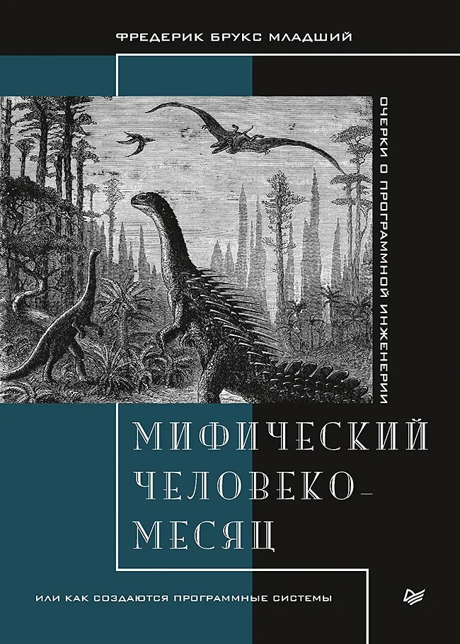

# 📖 Мифический человеко-месяц

Конспект книги
Мифический человеко-месяц, или Как создаются программные системы (юбилейное издание)
Фредерик Брукс

## 📚 О книге

Книга — классика управления программными проектами, написанная по итогам разработки IBM System/360 и OS/360. Она охватывает:
- Почему большие проекты срывают сроки: мифический «человеко-месяц», оптимизм программистов и закон Брукса
- Организацию команд: «бригаду хирургов», концептуальную целостность и роль архитектора
- Эффект второй системы и то, как донести решения архитектора до сотен исполнителей
- Коммуникацию и организацию больших проектов: Вавилонская башня, рабочая тетрадь, закон Конвея
- Оценку трудоёмкости, бюджеты размера программы и ключевые документы проекта
- «Планируйте на выброс», общий инструментарий, контроль изменений, системную сборку и отладку
- Вехи, контроль сроков и документацию, обращённую к человеку
- Статью «Серебряной пули нет», ответ её критикам и ретроспективу книги двадцать лет спустя

## 📑 Структура конспекта

### Главы
- [01. Смоляная яма](./chapters/ГЛАВА%201%20Смоляная%20яма.md)
- [02. Этот мифический «человеко-месяц»](./chapters/ГЛАВА%202%20Этот%20мифический%20«человеко-месяц».md)
- [03. Операционная бригада](./chapters/ГЛАВА%203%20Операционная%20бригада.md)
- [04. Аристократия, демократия и системное проектирование](./chapters/ГЛАВА%204%20Аристократия,%20демократия%20и%20системное%20проектирование.md)
- [05. Эффект второй системы](./chapters/ГЛАВА%205%20Эффект%20второй%20системы.md)
- [06. Донести слово](./chapters/ГЛАВА%206%20Донести%20слово.md)
- [07. Почему не удалось построить Вавилонскую башню](./chapters/ГЛАВА%207%20Почему%20не%20удалось%20построить%20Вавилонскую%20башню.md)
- [08. Объявляя удар](./chapters/ГЛАВА%208%20Объявляя%20удар.md)
- [09. Два в одном](./chapters/ГЛАВА%209%20Два%20в%20одном.md)
- [10. Документарная гипотеза](./chapters/ГЛАВА%2010%20Документарная%20гипотеза.md)
- [11. Планируйте на выброс](./chapters/ГЛАВА%2011%20Планируйте%20на%20выброс.md)
- [12. Острый инструмент](./chapters/ГЛАВА%2012%20Острый%20инструмент.md)
- [13. Целое и части](./chapters/ГЛАВА%2013%20Целое%20и%20части.md)
- [14. Назревание катастрофы](./chapters/ГЛАВА%2014%20Назревание%20катастрофы.md)
- [15. Обратная сторона](./chapters/ГЛАВА%2015%20Обратная%20сторона.md)
- [16. Серебряной пули нет](./chapters/ГЛАВА%2016%20Серебряной%20пули%20нет.md)
- [17. Новый выстрел «Серебряной пули нет»](./chapters/ГЛАВА%2017%20Новый%20выстрел%20«Серебряной%20пули%20нет».md)
- [18. Заявления «Мифического человеко-месяца» - правда или ложь](./chapters/ГЛАВА%2018%20Заявления%20«Мифического%20человеко-месяца»%20-%20правда%20или%20ложь.md)
- [19. «Мифический человеко-месяц» двадцать лет спустя](./chapters/ГЛАВА%2019%20«Мифический%20человеко-месяц»%20двадцать%20лет%20спустя.md)

### Дополнительные материалы
- [Главы 1–7: общий конспект](./comparisons/Главы%201-7%20ОБЩИЙ%20конспект.md)
- [Главы 8–15: общий конспект](./comparisons/Главы%208-15%20ОБЩИЙ%20конспект.md)
- [Главы 16–19: общий конспект](./comparisons/Главы%2016-19%20ОБЩИЙ%20конспект.md)

## 🔗 Связанные конспекты

- [ГЛАВА 22 Эффективная команда](../fundamental-software-architecture/chapters/ГЛАВА%2022%20Эффективная%20команда.md) — «Фундаментальный подход к программной архитектуре» (закон Брукса)
- [ГЛАВА 15 Организационные структуры](../building-microservices/chapters/ГЛАВА%2015%20Организационные%20структуры.md) — «Создание микросервисов» (закон Конвея, закон Брукса)
